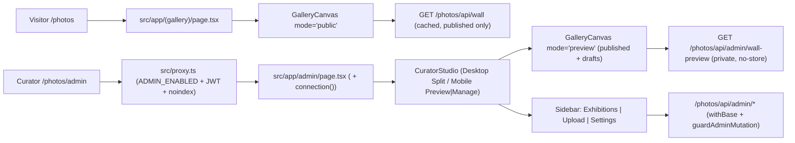

> [!NOTE]
> This document specifies **technical system architecture only** (data flow, storage, APIs, concurrency, state synchronization, and security).
> All visual, aesthetic, and UI design decisions (colors, typography, component styling, responsive layout) must be defined in `design.md`.

## Context

`photo-wall` serves under `BASE_PATH = '/photos'` on Vercel (`gregory-lazatin.com/photos/*` via portfolio rewrite). Today, `PhotoWallApp` mounts on `/` (served at `/photos`), calls `GET /photos/api/admin/auth` on every visitor load, renders a lock icon in `GalleryHud`, and lazy-imports `AdminDrawer`. Moving curation to `/photos/admin` inside the same Next.js app separates public vs. admin bundles, data paths, and auth enforcement without duplicating the WebGL2 PBR wall renderer or DB/storage layer.

## System Architecture Diagram

## Goals / Non-Goals

**Goals:**
- Public `/photos` ships `0 KB` of admin JS, makes zero `/api/admin/*` requests, and is visually unchanged.
- `/photos/admin` is fail-closed behind `ADMIN_ENABLED === 'true'` (`404` when off) and `photowall_session` JWT verification in `src/proxy.ts`, with route-handler guards retained as defense in depth.
- `/photos/admin` reuses the real `PlaygroundGallery` + `PlaygroundPbrWall` renderer via a pure `<GalleryCanvas>` seam fed by uncached `GET /photos/api/admin/wall-preview`.
- `/photos/admin` emits a studio-only CSP allowing `https://www.youtube.com` so curator soundtrack duration probing works while `/photos` keeps the strict public CSP.

**Non-Goals:**
- Private/signed Bunny image URLs for drafts (draft metadata stays out of `/photos/api/wall`, while draft image bytes remain behind unguessable UUIDv7 URLs).
- Full photo/album drag-to-reorder editor (lands next in `album-photo-management` inside the Studio's Exhibitions slot).
- PR #1 image sanitizer hardening (split into its own change).

## Technical Decisions

### D1. Route groups & zero-leakage boundary test
Move the public page into `src/app/(gallery)/page.tsx` and place the Studio under `src/app/admin/` (`page.tsx`, `login/page.tsx`, `layout.tsx`). Add `src/lib/__tests__/publicBoundaryAudit.test.ts` that walks the static import graph starting from `src/app/(gallery)` and fails CI if any transitive module imports `@/components/admin/*` or references `/api/admin`.

### D2. Fail-closed `src/proxy.ts` + Next 16 `cacheComponents` compatibility
- `src/proxy.ts` exports `config = { matcher: ['/admin/:path*', '/api/admin/:path*'] }` (Next 16 auto-prepends `basePath: '/photos'`).
- If `process.env.ADMIN_ENABLED !== 'true'`, return `404 Not Found` immediately.
- Otherwise, attach `X-Robots-Tag: noindex, nofollow` and verify `photowall_session` with `jose`:
  - `/admin/login` and `/api/admin/auth` pass through so login works.
  - Unauthenticated `/admin*` redirects to `withBase('/admin/login')`.
  - Unauthenticated `/api/admin/*` returns `401 Unauthorized`.
- `src/app/admin/page.tsx` wraps its async body in `<Suspense>` and calls `await connection()` / `await cookies()` before reading `process.env.ADMIN_ENABLED` or session state—never `export const dynamic = 'force-dynamic'` (incompatible with `cacheComponents: true`).
- Note on Vercel: toggling `ADMIN_ENABLED` takes effect on redeploy, not instantaneously.

### D3. Pure `<GalleryCanvas>` & uncached `GET /api/admin/wall-preview`
Extract `<GalleryCanvas albums lodUrl theme mode="public" | "preview" selectedAlbumId? onSelectAlbum? />` from `PlaygroundGallery.tsx`.
- `computeWallGridPositions(albums, { includeStatuses })` defaults to `['published']`; `GET /api/admin/wall-preview` passes `['published', 'draft']`, checks `requireAdmin`, and responds with `Cache-Control: private, no-store` and `X-Robots-Tag: noindex`.
- In `preview` mode, draft albums render with dashed mats and a `"Draft"` placard chip; clicking an island notifies `CuratorStudio` to select that album.

### D4. Persistent Split `CuratorStudio` replacing floating `AdminDrawer`
`CuratorStudio.tsx` renders `<GalleryCanvas mode="preview" />` beside a persistent `440px` sidebar (`Exhibitions` | `Upload` | `Settings`) on desktop (`>= 1024px`) and switches cleanly between **Preview** and **Manage** tabs on mobile (`< 1024px`) without unmounting state. All existing `FolderDropzone`, Lighting Preview, Placard Material, Pending Deletions, and Sign Out controls live inside **Upload** and **Settings**; every fetch uses `withBase()`.

### D5. Studio-only CSP in `next.config.ts` `headers()`
Extend `buildContentSecurityPolicy({ cdnOrigin, isDev, allowYoutubeApi })` in `src/lib/security/csp.ts`:
- Public entry: `source: '/((?!admin(?:/|$)).*)'` → `allowYoutubeApi: false` (strict public CSP unchanged).
- Studio entry: `source: '/admin/:path*'` (plus `'/admin'`) → `allowYoutubeApi: true`, adding `https://www.youtube.com` to `script-src` and `frame-src` so `loadYouTubeIframeApi()` probes soundtrack duration cleanly in Studio.

## Risks / Trade-offs

- **[Risk] `source` negative lookahead misses `/photos` root or `/photos/admin` exact match.** → Mitigation: explicitly include both `'/admin'` and `'/admin/:path*'` (and test `/photos`, `/photos/api/wall`, `/photos/admin`, and `/photos/admin/login` response headers in Playwright against `next start`).
- **[Risk] Admin code leaks back into `/photos` via a shared barrel import.** → Mitigation: `publicBoundaryAudit.test.ts` fails Vitest + Playwright asserts zero admin chunks on `/photos`.
- **[Risk] Draft image bytes remain public by UUIDv7 URL.** → Mitigation: explicitly documented non-goal; UUIDv7 paths are unguessable and excluded from `/photos/api/wall`.

## Migration & Rollback Plan

Set `ADMIN_ENABLED=true` in Vercel Production + Preview env before merging. Rolling back reverts the PR; no DB schema or storage changes are involved.
