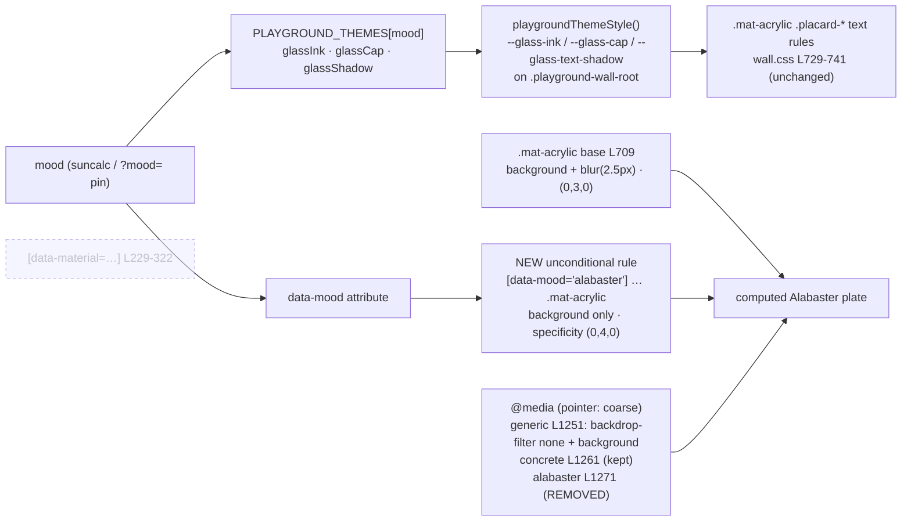

> [!NOTE]
> This document specifies **technical system architecture only** (data flow, storage, APIs, concurrency, state synchronization, and security).
> All visual, aesthetic, and UI design decisions (colors, typography, component styling, responsive layout) must be defined in `design.md`.

## Context

Placard text colour on the Beveled Glass material comes from two places, which have drifted apart.

1. **The theme layer.** `PLAYGROUND_THEMES[mood]` in `src/lib/lighting/playgroundTheme.ts` holds `glassInk`, `glassCap` and `glassShadow`. `playgroundThemeStyle()` turns them into scoped custom properties (`--glass-ink`, `--glass-cap`, `--glass-text-shadow`) on `.playground-wall-root`. The `.mat-acrylic` text rules (`wall.css:729-741`) read only those variables.
2. **The CSS plate layer.** `wall.css` provides:
   - one desktop `.mat-acrylic` background shared by every mood (`L709-727`);
   - mood-scoped overrides that exist only inside `@media (pointer: coarse)` (`L1251-1280`).

The Alabaster theme still carries dark ink with a white halo. Those values were written for the pale frosted plate in the dead `[data-material='beveled-glass']` rules (`L229-322`), which no element matches. research.md has the contrast numbers.

Constraints:

- Desktop parity for every surface other than Alabaster Beveled Glass.
- The `touchAudit.test.ts` coarse-block invariants must stay green unchanged.
- There is no JS or runtime behaviour change. The change is theme data plus CSS.

## System Architecture Diagram



## Goals / Non-Goals

**Goals:**
- Alabaster Beveled Glass text uses light ink with no text-shadow, through the existing theme path.
- One source for the Alabaster plate tint, shared by both pointer profiles.
- Remove the dead `[data-material]` CSS so the stale design can't mislead the next reader.
- A browser-free regression test that measures contrast from source.

**Non-Goals:**
- Chiaroscuro and Concrete ink, shadow or plate.
- Brushed Aluminum, Archival Foamcore, or `DEFAULT_PLACARD_MATERIAL`.
- Soundtrack footer layout, the divider, the marquee or the timecode.
- The `placardInk` mood token, `--mood-placard-ink`, `moodBlend.ts`, and `.museum-placard[data-tier='macro']`.

## Technical Decisions

### D1: Change the ink in the theme data, not in CSS

Set the three Alabaster values in `PLAYGROUND_THEMES.alabaster`:

- `glassInk '#F4F6F4'`
- `glassCap 'rgba(240, 244, 241, 1)'`
- `glassShadow 'none'`

`none` is a valid `text-shadow` value, so `text-shadow: var(--glass-text-shadow, …)` resolves to `none` without the fallback firing, because the variable is defined.

**Alternative:** add `[data-mood='alabaster'] … .mat-acrylic .placard-*` colour overrides in `wall.css`. Rejected. It leaves the theme lying about the ink and creates a second source of truth.

**Why cap alpha 1.0 rather than 0.92:** `.placard-meta` and `.placard-timecode` multiply by `opacity: 0.72`. At 0.92 the middle stop measures 4.37:1. At 1.0 the worst stop is 5.09:1 (research.md).

### D2: Move the Alabaster plate out of the coarse block

Add one unconditional rule directly after the `.mat-acrylic` base rule (after `wall.css:727`):

```css
[data-mood='alabaster'] .playground-wall-root .museum-placard.mat-acrylic,
.playground-wall-root[data-mood='alabaster'] .museum-placard.mat-acrylic {
  background: linear-gradient(138deg, rgba(30,36,33,0.78) 0%, rgba(22,27,24,0.74) 55%, rgba(34,40,36,0.78) 100%);
}
```

Then delete the coarse Alabaster rule at `L1271-1279`.

- At (0,4,0), the new rule beats both the desktop base (0,3,0) and the coarse generic rule (0,3,0) regardless of source order, so both profiles compute the same plate.
- The rule sets `background` only, so `backdrop-filter` keeps coming from the base rule (`blur(2.5px)`) or the coarse generic rule (`none`).
- The coarse generic and Concrete rules stay, so `touchAudit` still finds a coarse `.mat-acrylic` rule with `backdrop-filter: none`, and no backdrop rule leaves `.mat-acrylic`.
- Keep the dual selector form (`[data-mood] .playground-wall-root` and `.playground-wall-root[data-mood]`). That matches the existing coarse rules, because `data-mood` can sit on the root or on an ancestor (`PhotoWallApp.tsx:139`).

**Alternative:** keep both rules (coarse and unconditional) with the same values. Rejected, because it's the duplicated tint that drifted in the first place.

### D3: Delete the dead `[data-material]` block

Remove `wall.css:229-322`, from the `/* Beveled Glass Standoff (default)…` comment through the `rag-paper` rule. The live `.museum-placard` base (`L194-206`), the `.placard-*` rules (`L208-226`) and the `[data-tier='macro']` rules (`L324-332`) stay.

Nothing renders `data-material` (research.md, Verified facts), so this is pixel-neutral by construction. Parity proves it.

### D4: A source-text contrast audit instead of a browser test

Add `src/lib/__tests__/placardGlassLegibility.test.ts`, modelled on `touchAudit.test.ts`. It does six things:

1. Imports `PLAYGROUND_THEMES` and asserts the Alabaster values.
2. Reads `wall.css`, strips comments, finds the unconditional Alabaster `.mat-acrylic` rule (outside any `@media`), and parses its `rgba()` stops. It does the same for the desktop base rule, which Chiaroscuro and Concrete use.
3. Computes WCAG contrast for each mood, line and stop. The ink is composited at its line opacity over the plate stop, and the stop over the mood's `wallBase`. It asserts at least 4.5.
4. Asserts that the coarse block contains no Alabaster `.mat-acrylic` rule.
5. Asserts that `wall.css` contains no `[data-material`.
6. Asserts that the Chiaroscuro and Concrete theme glass values equal their current literals (a guard against collateral edits).

The line opacities (0.72 and 0.92) are read from `wall.css` rather than hard-coded, so a later opacity tweak can't silently bypass the floor.

**Alternative:** a Playwright computed-style test. Rejected as the gate, because it's slow and needs a server. Computed styles and pixels are still captured once in the parity run (tests.md).

## Risks / Trade-offs

- **[Spot-lit wall brighter than `wallBase` behind the plate]** → The floor is asserted over `wallBase`, with headroom (worst case 5.09, or 4.70 over a `#E6E2DA` proxy). Verification samples the real composited pixel from a screenshot and records it.
- **[Mood crossfade shows a mid-blend ink]** → The `--glass-*` values switch with the theme object and the plate switches with `data-mood`. This is the same mechanism Chiaroscuro↔Concrete already uses, and it isn't new behaviour.
- **[Deleting CSS someone still relies on]** → The grep evidence is in research.md, and desktop parity over all moods × materials must show 0 px.
- **[The phone plate's middle stop changes from 0.70 to 0.74]** → An intentional, small darkening on coarse Alabaster. It is covered by the device check.

## Migration & Rollback Plan

- This is client-only theme data and CSS with no data or API impact. It ships with the normal Vercel deploy.
- **Rollback:** revert the PR.
- Verify on local dev only (`STORAGE_DRIVER=local`, `?demo=4&mood=…`), or by read-only viewing of the preview. Nothing writes to Turso or Bunny.
