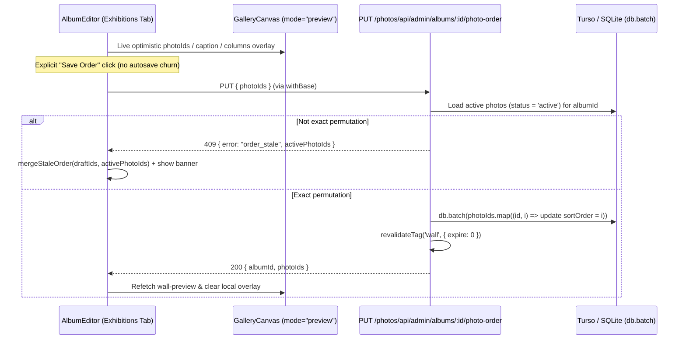

> [!NOTE]
> This document specifies **technical system architecture only** (data flow, storage, APIs, concurrency, state synchronization, and security).
> All visual, aesthetic, and UI design decisions (colors, typography, component styling, responsive layout) must be defined in `design.md`.

## Context

`admin-route-isolation` establishes `/photos/admin` with `<GalleryCanvas mode="preview" />`, `GET /photos/api/admin/wall-preview`, and the 3-tab Studio Sidebar (`Exhibitions | Upload | Settings`). `album-photo-management` fills the `Exhibitions` workspace with atomic within-album photo ordering, cross-wall album ordering, and full album metadata/soundtrack editing without adding any DB schema migration.

## System Architecture Diagram

## Goals / Non-Goals

**Goals:**
- Single round-trip atomic `db.batch` persistence for both photo order (`0..n-1`) and album order (`0..m-1`), with one `revalidateTag('wall', { expire: 0 })` per save.
- Zero-column optimistic concurrency via strict full-permutation validation (`409 order_stale` returning current active IDs).
- Exact wall consistency: public wall, Studio preview, Album Focus, and Print Focus `← Prev` / `Next →` all read the same persisted `sortOrder`.
- Zero DB schema migrations by storing unified Caption in `albums.title` and formatted Date + Time (`<input type="date">` + `<input type="time">`) together in `albums.dateLabel`.

**Non-Goals:**
- Fractional indexing or sparse gap schemes (albums are capped at `MAX_PHOTOS_PER_ALBUM = 20`).
- Per-photo EXIF/caption/location columns (separate future schema change).

## Technical Decisions

### D1. Atomic full-permutation `db.batch` in `src/db/repository.ts`
- `reorderAlbumPhotos(albumId, photoIds)`: fetches album (`404` if missing, `409 album_deleting` if deleting), fetches all active (`status = 'active'`) photo IDs for `albumId`, validates exact set equality (`length`, `Set.size`, membership), and executes `db.batch(photoIds.map((id, i) => db.update(photos).set({ sortOrder: i }).where(and(eq(photos.id, id), eq(photos.albumId, albumId), eq(photos.status, 'active')))))`. Empty album (`[]`) is a harmless no-op.
- `reorderAlbums(albumIds)`: identical pattern across all non-`deleting` albums (`status IN ('published', 'draft')`), returning `409 order_stale` with `activeAlbumIds` on mismatch.

### D2. Pure state & conflict merge (`src/components/admin/photoOrderState.ts`)
- `moveItem`, `moveToFirst`, `moveToLast`, `isOrderDirty`, and `mergeStaleOrder(draftIds, serverActiveIds)` live in a pure module so Vitest verifies all edge cases (concurrent upload appended at end, concurrent delete dropped, no duplicates) without DOM mocking.
- Date/time formatting helpers (`formatCombinedDateLabel(dateIso, time24)` and `parseCombinedDateLabel(dateLabel)`) also live in a pure helper so `<input type="date">` and `<input type="time">` round-trip cleanly through `albums.dateLabel`.

### D3. Live `<GalleryCanvas>` optimistic overlay & `@dnd-kit/sortable`
- `CuratorStudio` holds an optional in-memory `localDraftOverlay` (unsaved photo order, album order, caption, gridColumns, metadata, soundtrack) layered onto the `wall-preview` manifest passed to `<GalleryCanvas mode="preview" />`.
- `@dnd-kit/core`, `@dnd-kit/sortable`, and `@dnd-kit/utilities` are imported strictly inside `src/components/admin/` so `publicBoundaryAudit.test.ts` guarantees `0 KB` impact on `/photos`.
- Every fetch uses `withBase()` so `rawUrlAudit.test.ts` passes.

## Risks / Trade-offs

- **[Risk] Simultaneous edit in two tabs causes `409 order_stale`.** → Mitigation: `mergeStaleOrder` keeps the curator's relative arrangement for surviving prints, appends newly uploaded prints at the end, and displays a clear warning banner so the curator can review and click **Save Order** again.
- **[Risk] Narrow 4-column sidebar tiles overflow with 5 action buttons.** → Mitigation: top-right thumbnail `×` delete overlay + 4-column equal-width directional grid (`repeat(4, minmax(0, 1fr))`), already validated at `0` overflows in `playgrounds/album_curator_playground.html`.

## Migration & Rollback Plan

Zero DB migrations. Rolling back reverts the PR; previously persisted `sortOrder` values remain valid integers.
