# Architecture: Gallery Style and Canvas Refactor

> [!NOTE]
> This document specifies **technical system architecture only** (module seams, stylesheet loading boundaries, static CI guardrails, and refactor safety).
> All visual, aesthetic, and UI design decisions are defined in `design.md`.

## Context

After PR #6 (`admin-route-isolation` + `album-photo-management` + PATCH-01) merges to `main`, the application has a clean route boundary (`/photos` vs `/photos/admin`), a pure `<GalleryCanvas>` renderer (`~1,094` lines), and a full Curator Studio with `src/app/admin/studio.css`. However, legacy styling and component debt remains:
- `src/app/globals.css` (`~1,413` lines) mixes tokens, **51 `.admin-*` rules** (most of which are live Studio rules used by `FolderDropzone`, `AlbumEditor`, and `CuratorStudio`; only `.admin-drawer*` is dead), dead R3F rules, and a duplicate `.hud-*`/`.photo-focus-*` override block (`L1295–L1413`).
- `src/app/playground-wall.css` (`~981` lines) duplicates tokens and HUD rules under `.playground-wall-root`.
- `GalleryCanvas.tsx` (`~1,094` lines) mixes camera/gesture orchestration with placard, framed-print, and macro-mosaic rendering.
- `PlaygroundPbrWall.tsx` hardcodes `WALL_TILE_UNITS`, `uNormalStrength`, and `uAoStrength` inline instead of consuming a shared config object.
- `DESIGN.md` still describes PR #1's R3F architecture.

This change performs a **behavior-preserving structural refactor** immediately after PR #6 + PATCH-01 merges and before `gallery-visual-fidelity`, verified objectively against a pre-refactor `getComputedStyle` + screenshot baseline.

## System Architecture Diagram

```mermaid
flowchart TD
  RootLayout["src/app/layout.tsx"] --> Globals["src/app/globals.css\n(reset, .gallery-root, .sr-only\n+ @import tokens.css)"]
  GalleryLayout["src/app/(gallery)/layout.tsx\n(or page)"] --> WallCSS["src/styles/wall.css\n(.playground-wall-root, .gallery-root-inner,\nwall, placard, print, mosaic)"]
  GalleryLayout --> HudCSS["src/styles/hud.css\n(.hud-*, .photo-focus-*)"]
  AdminLayout["src/app/admin/layout.tsx"] --> WallCSS
  AdminLayout --> StudioCSS["src/styles/studio.css\n(git mv from app/admin/studio.css\n+ live .admin-* rules)"]

  Canvas["GalleryCanvas.tsx\n(owns camera/viewport/world refs,\ngestures, keymap, culling)"] --> Pbr["PlaygroundPbrWall.tsx\n(reads WALL_SHADER_CFG)"]
  Canvas --> Placard["AlbumPlacard.tsx\n(pure presentational)"]
  Canvas --> Print["FramedPrint.tsx\n(local hover tilt/sheen,\nreads wasDragged())"]
  Canvas --> Macro["MacroIsland.tsx\n(wraps macroMosaic.ts)"]
  Canvas --> Plaque["SoundtrackPlaque.tsx"]

  Audit["cssBoundaryAudit.test.ts"] -.->|prefix + no-dup-selector| Globals
  Audit -.->|prefix + no-dup-selector| WallCSS
  Audit -.->|prefix + no-dup-selector| HudCSS
  Audit -.->|admin-only import + no-dup| StudioCSS
```

## Goals / Non-Goals

**Goals:**
- Reduce `src/app/globals.css` to a minimal reset + `.gallery-root` + `.sr-only` + `@import '../styles/tokens.css';`, delete `src/app/playground-wall.css`, and preserve **every live `.admin-*` rule** by migrating it into `src/styles/studio.css` (moved via `git mv` from `src/app/admin/studio.css`).
- Update `@font-face` paths in `src/styles/tokens.css` to `url('../app/fonts/texgyreheros-*.woff2')` and update `src/lib/__tests__/rawUrlAudit.test.ts` accordingly, verifying font loading via `document.fonts.check('16px "TeX Gyre Heros"')`.
- Guarantee **zero visual regressions** via a pre-refactor Playwright `getComputedStyle` JSON snapshot + screenshot baseline compared post-refactor.
- Keep `GalleryCanvas.tsx` owning all camera/viewport/world DOM refs while delegating presentation to `AlbumPlacard.tsx`, `FramedPrint.tsx`, and `MacroIsland.tsx`.
- Export `WALL_SHADER_CFG` from `src/lib/lighting/playgroundLighting.ts` with exact value preservation (`{ tileUnits: 5.2, normalStrength: 1.4, aoStrength: 0.75 }`).
- Enforce domain ownership AND zero cross-file duplicate top-level selectors in `src/lib/__tests__/cssBoundaryAudit.test.ts`.

**Non-Goals:**
- Changing visual styling, lighting parameters, placard gap, 2D glare, or HUD colors (deferred to `gallery-visual-fidelity`).
- Renaming existing DOM class names (`.museum-placard`, `.photo-frame`, `.photo-sheen`, `.hud-*`, `.photo-focus-bar`, `.admin-*`).
- Changing any API route, database table, or auth proxy behavior.

## Technical Decisions

### D1. Five Complete, Non-Overlapping Plain CSS Files + `git mv` for `studio.css`
- **Decision:** Partition all styles across `src/app/globals.css`, `src/styles/tokens.css`, `src/styles/wall.css`, `src/styles/hud.css`, and `src/styles/studio.css` (moved via `git mv src/app/admin/studio.css src/styles/studio.css` to preserve git history). Every wrapper/utility selector has an explicit home (`design.md` Stylesheet Domain Map). Every `.admin-*` rule in `globals.css` is grepped against `src/` before deletion: live rules move to `src/styles/studio.css`, and only `.admin-drawer*` + unreferenced rules are deleted.
- **Font Path & Audit Alignment:** `@font-face` in `src/styles/tokens.css` uses `url('../app/fonts/texgyreheros-*.woff2')`; `src/lib/__tests__/rawUrlAudit.test.ts` (`L66–L70`) is updated to check `src/styles/tokens.css` while keeping the no-absolute-`/fonts/` guard.
- **Alternative considered:** CSS Modules (`*.module.css`). Rejected because hashed class names would break `GalleryCanvas`'s `.closest('.photo-frame')` gesture guards and Playwright selectors.

### D2. Static CSS Boundary + Cross-File Duplicate-Selector Audit (`src/lib/__tests__/cssBoundaryAudit.test.ts`)
- **Decision:** Add a fast Vitest test that reads `src/app/globals.css`, `src/styles/{tokens,wall,hud,studio}.css`, `DESIGN.md`, and layout imports to assert:
  1. `globals.css` has zero `.hud-`, `.photo-focus-`, `.admin-`, `.soundtrack-overlay`, or `.gallery-canvas` selectors.
  2. `wall.css` has zero `.hud-` or `.admin-` selectors; `hud.css` has zero `.admin-` selectors.
  3. `studio.css` is imported exclusively inside `src/app/admin/`.
  4. `src/app/playground-wall.css` does not exist.
  5. **Cross-file duplicate-selector check:** extract and normalize top-level CSS selectors (stripping comments and `@media`/`@font-face` wrappers) across all 5 stylesheets and fail if any selector appears in more than one file.
  6. `DESIGN.md` contains zero stale `troika-three-text`, `matrix3d`, or `AdminDrawer` references.
- **Rationale:** Enforces the full "non-overlapping stylesheets" guarantee — not just prefix bans — so duplicate override blocks can never silently return.

### D3. Component Decomposition & Ref Ownership (`GalleryCanvas.tsx`)
- **Decision:**
  - `GalleryCanvas.tsx` retains ownership of `containerRef`, `worldRef`, `wallRef`, camera/flight refs, pointer/wheel/pinch/keymap handlers (`0`, `Escape`, `ArrowLeft`, `ArrowRight`, `+`, `=`, `-`, `_`), and `visibleIslands` culling.
  - `AlbumPlacard.tsx`: pure presentational component receiving `{ album, placedStyle, lightingVars, material, mode, onSelectAlbum, wasDragged }`.
  - `FramedPrint.tsx`: receives `{ albumTitle, photo, index, frameSize, lodUrl, lodWidth, tier, scale, focused, dimmed, lightingVars, onSelectAlbum, onSelectPhoto, wasDragged }`; owns local `onPointerMove` / `onPointerLeave` hover tilt and `.photo-sheen` transform on its own `<button>` element, guarding clicks/hover via `wasDragged()`.
  - `MacroIsland.tsx`: thin wrapper around existing `src/components/wall/macroMosaic.ts` (`{ album, lodUrl, onSelect }`).
- **Rationale:** Keeping camera/world DOM refs owned by `GalleryCanvas` guarantees zero behavioral change while isolating `FramedPrint.tsx` (~120 lines) and `AlbumPlacard.tsx` (~90 lines) for `gallery-visual-fidelity`.

### D4. Export `WALL_SHADER_CFG` from `src/lib/lighting/playgroundLighting.ts`
- **Decision:** Export `export const WALL_SHADER_CFG = { tileUnits: 5.2, normalStrength: 1.4, aoStrength: 0.75 } as const;` and import it in `PlaygroundPbrWall.tsx`, asserted verbatim in `playgroundLighting.test.ts`.

## Risks / Trade-offs

- **[Risk] Cascade / specificity differences when deduplicating `globals.css` + `playground-wall.css` into route-scoped stylesheets.** → **Mitigation:** Capture a deterministic pre-refactor Playwright `getComputedStyle` JSON snapshot + screenshots (Task `1.1`) across `/photos` (`chiaroscuro` & `concrete`) and `/photos/admin`, and diff post-refactor in Task `5.2` (exact computed-style match + `<= 0.5%` `pixelmatch` screenshot tolerance + `document.fonts.check`).
- **[Risk] Deleting a live `.admin-*` rule breaks Upload or Details tab in Studio.** → **Mitigation:** Explicit grep classification step (Task `2.1`) before deleting any selector, plus `/photos/admin` computed-style baseline assertions.
- **[Risk] `gallery-visual-fidelity` Target Context Map becomes stale after this refactor merges.** → **Mitigation:** Explicit follow-up Task `5.3` runs `openspec-revise-change gallery-visual-fidelity` to point its 7 `playground-wall.css` / `PlaygroundGallery` references at `src/styles/{tokens,wall,hud}.css`, `FramedPrint.tsx`, `AlbumPlacard.tsx`, and `WALL_SHADER_CFG`.

## Migration & Rollback Plan

- Gated on PR #6 (+ PATCH-01) merging to `main` first (Task 0).
- Pure internal structural refactor with zero DB/API/env changes; rollback is a single `git revert`.
