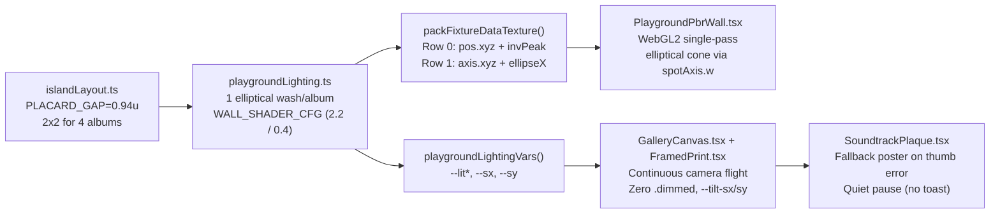

# Architecture: Gallery Visual Fidelity

> [!NOTE]
> This document specifies **technical system architecture only** (data flow, storage, APIs, concurrency, state synchronization, and security).
> All visual, aesthetic, and UI design decisions (colors, typography, component styling, responsive layout) are defined in `design.md`.

## Context

Following `gallery-style-and-canvas-refactor` (PR #7), the photo wall renders an infinite 2D-transformed DOM exhibition wall (`GalleryCanvas.tsx` delegating to `AlbumPlacard.tsx`, `FramedPrint.tsx`, `MacroIsland.tsx`, `SoundtrackPlaque.tsx`) composited over a single-pass WebGL2 PBR plaster canvas (`PlaygroundPbrWall.tsx`), with modular CSS split cleanly across `src/styles/{tokens,wall,hud,studio}.css`. Geometry (`islandLayout.ts`), analytic lighting (`playgroundLighting.ts` + `WALL_SHADER_CFG`), and theme uniforms (`playgroundTheme.ts`) share a single pure-TypeScript coordinate system (`100px = 1 world unit`, y-up in world space, y-down negated at GPU upload).

Current visual regressions stem from four architectural/pipeline mismatches:
1. **Multi-head fixture generation** in `playgroundLighting.ts` spawns `ceil(cols / 2)` narrow spots over the photo grid only, excluding the placard and producing scalloped wall hotspots.
2. **Circular cone math** in `PlaygroundPbrWall.tsx` and `rawIrradiance()` has no horizontal elliptical shaping, so a single fixture cannot evenly wash a wide rectangular album island (placard + 4–5 photo columns).
3. **Oversized plaster surface values** in `WALL_SHADER_CFG` (`tileUnits: 5.2`, `normalStrength: 1.4`) scale poorly at high zoom (`viewMode === 'print'`), exposing coarse normal-map relief.
4. **Legacy duplicate HUD blocks** preserved verbatim inside `src/styles/hud.css` (from the behavior-preserving refactor) still force `text-transform: uppercase`, dark inspection bars, and rounded corners, while `GalleryCanvas.tsx` / `FramedPrint.tsx` still pass `dimmed` and mount `.soundtrack-toast` on zoom-out.

## System Architecture Diagram

## Goals / Non-Goals

**Goals:**
- Unify wall shader and DOM object shading around **1 elliptical wash fixture per album island** using the unused `w` channel of Row 1 in the existing `RGBA32F` `uSpotTexture` (`spotAxis.w = ellipseX`) — zero extra texture fetches or uniforms.
- Maintain a single geometry source of truth in `islandLayout.ts` for `PLACARD_GAP = 0.94u` and 4-album `2×2` row chunking so camera framing, culling, lighting, and DOM placement remain locked to `<= 1px`.
- Keep single-photo pointer tilt and shadow updates 100% imperative on the hovered `.photo-frame` element (no React state re-renders during `pointermove`).
- Keep zero new runtime dependencies, zero DB changes, and zero API changes.

**Non-Goals:**
- Altering authentication, route isolation, or Curator Studio layout (owned by `admin-route-isolation`).
- Altering album/photo drag-and-drop reordering, `Details` tab form fields, or placard data anatomy (owned by `album-photo-management`).
- Replacing the WebGL2 plaster wall or introducing Three.js.

## Technical Decisions

### 1. Pack Horizontal Ellipse Stretch into `uSpotTexture` Row 1 `.w`
- **Decision:** Store each cluster's horizontal ellipse stretch factor `ellipseX` (`>= 1.0`, derived from `islandWidth / islandHeight`) in `spotAxis.w` (currently hardcoded `0` in `packFixtureDataTexture`). Both `rawIrradiance()` on CPU and `FRAGMENT_SHADER` on GPU scale the horizontal vector component `dx / ellipseX` before computing `dot(-L, axis)` and `r`.
- **Rationale:** Keeps the `RGBA32F` texture layout 2 rows × `N` spots with zero additional texture lookups, guarantees 1:1 mathematical parity between the WebGL2 wall wash and DOM `--lit*` shading, and automatically adapts wash width to narrow (2-col) vs wide (5-col) albums.
- **Alternative considered:** Spawning a second fill-light fixture over each placard. Rejected because two overlapping cones still create a visible double-scallop crease between the placard and column 0.

### 2. Balanced 4-Album `2×2` Row Chunking & Aligned Entry Framing
- **Decision:** Export a pure helper `albumsPerRowForCount(count: number): number` from `islandLayout.ts` returning `2` when `count === 4` and `ALBUMS_PER_ROW` (`3`) otherwise. Update `PlaygroundGallery.tsx` entry Overview framing to compute `entryFirstRowCount(albums.length, aspect) = Math.min(aspect >= 1.4 ? 3 : aspect >= 0.9 ? 2 : 1, albumsPerRowForCount(albums.length))` before calling `computeFirstRowBounds(placements, firstRowCount)`.
- **Rationale:** Eliminates the orphaned 4th album in 4-album galleries (including `?demo=4`) without breaking the 3-column grid for 3, 5, 6, or 50-album walls, AND prevents wide desktop viewports (`aspect >= 1.4`) from slicing the first 3 placements (which would mistakenly include row 1's first album in `computeFirstRowBounds`).
- **Alternative considered:** Changing `ALBUMS_PER_ROW` globally to `2`, or leaving entry framing derived purely from viewport aspect. Rejected because 3 columns scales better for 6–50 album exhibitions, and aspect-only entry framing misframes 4-album `2×2` walls on wide desktops.

### 3. Imperative Tilt Shadow & 2D Glare Updates via CSS Custom Properties
- **Decision:** During `onPointerMove` on `.photo-frame`, write `--tilt-sx` and `--tilt-sy` (computed from `-rotateY` and `rotateX`) onto the frame element and `translate3d(${(-nx * 36).toFixed(1)}%, ${(-ny * 36).toFixed(1)}%, 0)` onto `.photo-sheen`; clear both in `onPointerLeave`.
- **Rationale:** Zero React re-renders per mousemove frame; browser compositor handles transform + shadow smoothly.

### 4. Remove `.dimmed` State Without Changing Camera Physics
- **Decision:** Delete the `dimmed` class assignment in `PlaygroundGallery.tsx` and the `.photo-frame.dimmed` opacity/filter rule in `playground-wall.css`. Keep `focused` solely for z-index elevation (`z-index: 40`), slight lift (`translateZ(54px)`), and clearing `.is-lit::after`.
- **Rationale:** All neighboring frames remain mounted and painted at 100% fidelity during `print` focus and `PREV`/`NEXT` flights, eliminating ghosting and placeholder flash.

## Risks / Trade-offs

- **[Risk] Changing `PLACARD_GAP` from `0.44` to `0.94` shifts existing `islandLayout.test.ts` numeric snapshots** → **Mitigation:** Update `islandLayout.test.ts` and `playgroundLighting.test.ts` expectations alongside the geometry constant change; because `PlaygroundGallery`, `SoundtrackPlaque`, `macroMosaic`, and `playgroundLighting` all read `PLACARD_GAP` from `islandLayout.ts`, no downstream drift can occur.
- **[Risk] `globals.css` rules re-overriding `.playground-wall-root` HUD styles** → **Mitigation:** Remove the conflicting `text-transform: uppercase` and dark-surface overrides from `globals.css:L1315–L1388` so `playground-wall.css` is the single source of truth for gallery HUD styling.

## Migration & Rollback Plan

- Pure frontend/shader/CSS change with zero database or API migrations.
- Rollback is a single `git revert` of the change commit.
