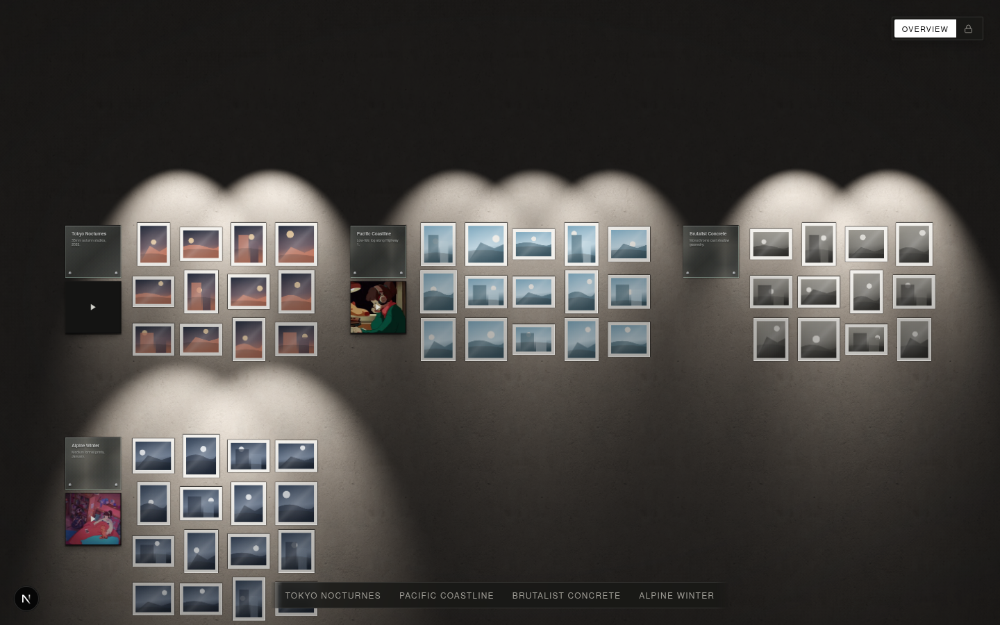
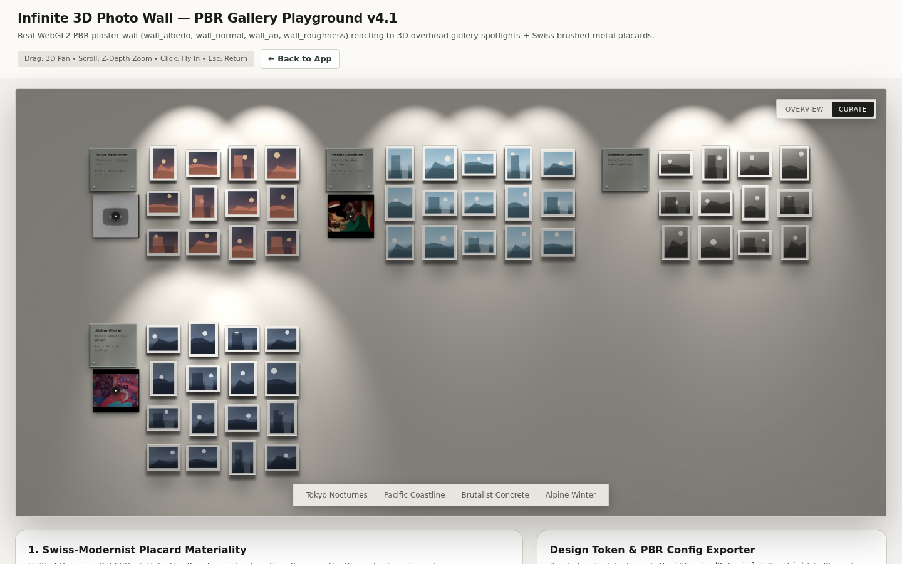
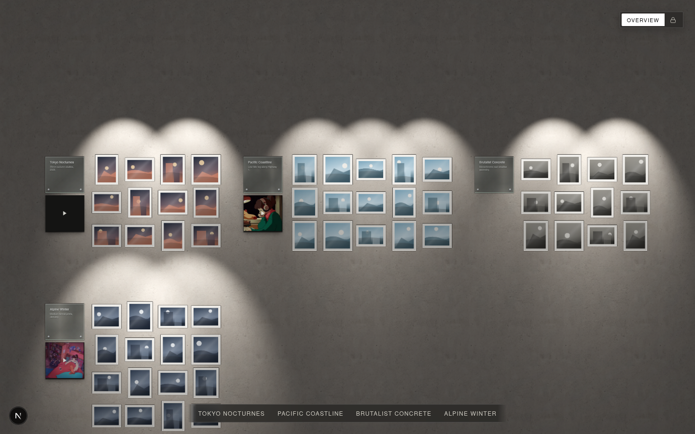
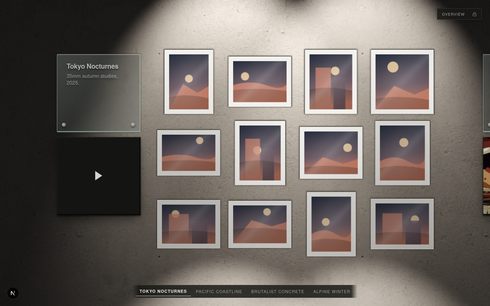
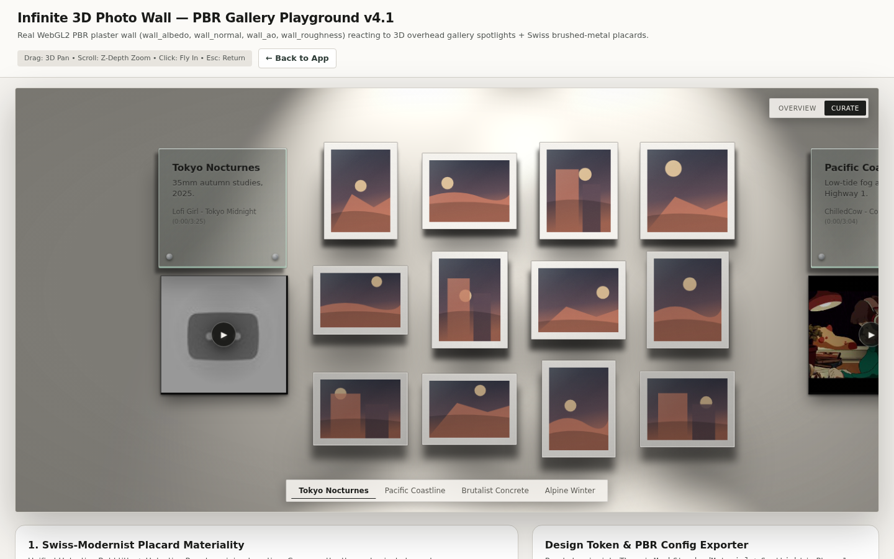
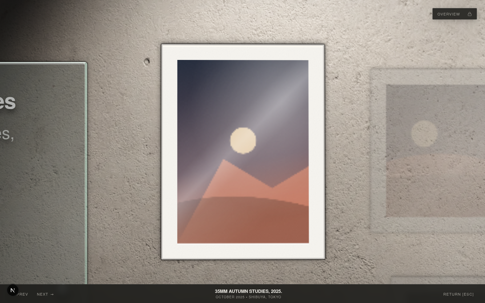

# Research: Gallery Visual Fidelity

## Source material

### 2026-11-24 — User Visual Parity Audit (`Visual Playground` vs `Vercel Deployment`)

> The gap between the **Visual Playground** (`video_1.mov`) and your **Vercel Deployment** (`video_2.mov`) comes down to five specific rendering, proportion, and CSS token differences. Even when sharing the underlying 3D/tilt logic, differing lighting values, texture UV scales, layout proportions, and global stylesheet overrides are breaking the realism.
>
> #### 1. Lighting & Spotlight Realism
> - **Harsh Triple-Hotspots vs. Soft Gallery Wash:** Each album has three separate, overly intense radial/spot hotspots pinned directly above the top frames, creating bright white scallops on the wall while starving the placards and lower rows of light.
> - **Fix:** Replace the three tight hotspots per cluster with **one wide, low-intensity elliptical spotlight** centered slightly above the cluster midpoint, and raise the global ambient light level so the interstitial plaster wall reads as warm charcoal-taupe (`#5A5650`–`#6E6A63`) rather than pitch black.
> - **Placards Starved of Light:** Extend the horizontal radius of each album's light pool (or add a dedicated soft fill light grazing the placard) so the silver aluminum / beveled placard catches realistic specular brightness.
>
> #### 2. Wall Texture Scale & 3D Frame Geometry
> - **Oversized Stucco Bump Scale:** When inspecting a print, the wall texture's UV repeat is too low and its normal/bump strength is too high, making the plaster pores look like deep concrete craters.
> - **Fix:** Double or triple the texture's UV `repeat` tiling so the plaster grain becomes fine and architectural, and cut `normalScale` in half (`~0.3–0.4`) so surface relief stays subtle at close range.
> - **Missing Frame Extrusion & Tight Spacing:** Each framed print needs a visible 3D side edge (`border-right` / `border-bottom` depth bevel) and enough horizontal breathing room from its placard so the placard never photobombs a zoomed-in print. Increase the horizontal gap between the placard column and the photo grid by ~40–60px.
>
> #### 3. Brushed-Metal Placard Proportions & Styling
> - **Vertical Stretching & Dark Gradient:** Lock the placard to a compact, fixed aspect ratio (`align-self: flex-start`), restore the bright brushed-aluminum gradient (`linear-gradient(135deg, #E4E6E8 0%, #C2C6CA 55%, #AEB2B6 100%)`) with a `3px` solid `#141414` bottom/right core edge, and scale the Helvetica Bold title (`16–17px`, `#111111`) and Helvetica Regular caption (`13px`, `#222222`).
> - **Broken YouTube Embed Thumbnails:** Ensure fallback thumbnail artwork or an initialized player poster renders immediately in Overview and Cluster Focus states instead of an empty black rectangle.
>
> #### 4. Unfinished HUD Menus & Font Overrides
> - **Enforce Global Helvetica & Remove `uppercase`:** Strip `uppercase` and `tracking-widest` utility classes from the bottom collection dock and close-up metadata bar so collection titles render in clean **Title Case** (`Tokyo Nocturnes`, `Pacific Coastline`) using `"Helvetica Neue", Helvetica, Arial, sans-serif`.
> - **Fix the Top-Right Switcher:** Remove `border-radius`, `gap`, and translucent glass backgrounds. Join buttons flush (`gap: 0`, `border-radius: 0`), using solid `#FFFFFF` fill + `#111111` text for active and solid `#111111` fill + `#FFFFFF` text for inactive.
> - **Restore the Light Inspection Bar & Quiet Transitions:** Change the close-up bottom bar from a cramped dark bar with stacked uppercase text back to the Playground's bright, spacious frosted bar (`rgba(244, 244, 242, 0.92)` with `#111111` text, single-line centered caption, and clean `← PREV` / `NEXT →` / `RETURN [ESC]` controls), and remove the heavy `PAUSED SOUNDTRACK ON ZOOM OUT` toast popup.
>
> #### 5. Single-Photo Inspection Mode Realism
> 1. **2D Specular Glare Tracking vs. Single-Axis Diagonal Streak:** Replace the 1D linear streak with a large, soft **2D radial/elliptical specular sheen** whose `X` and `Y` translation offsets update independently from normalized `mouseX` and `mouseY` (`translate3d(xOffset, yOffset, 0)`), moving opposite to the tilt angle.
> 2. **Neighboring Frame Ghosting & Placeholder Fades:** Remove `.dimmed` ghosting (`opacity: 0.26; filter: brightness(0.65)`) so all adjacent frames stay fully rendered at 100% material fidelity in the periphery during single-photo inspection.
> 3. **3D Frame Extrusion & Tilt-Reactive Cast Shadows:** Add explicit 3D side-edge thickness to the frame (asymmetric right/bottom bevels) and bind the wall drop shadow's `offsetX` and `offsetY` directly to `-rotateY` and `rotateX` so lifting an edge visibly deepens the shadow beneath it.
> 4. **Camera Transition Physics (`NEXT` / `PREV` & Zoom-In):** Drive single-photo inspection and `PREV` / `NEXT` navigation purely through the same continuous 3D camera transform target (`x, y, z`) without swapping DOM states, remounting images, or fading neighbor visibility.

### Existing UI Reference Screenshots (Captured 2026-11-24 at 1440×900)

Baseline captures of the current `main` branch (`7d29f11`) vs. `playgrounds/photo_wall_playground.html`:

| State | Existing App (`main`) | Visual Playground (`photo_wall_playground.html`) | Key Defects Observed |
| :--- | :--- | :--- | :--- |
| **Overview (`chiaroscuro`)** |  |  | Near-black wall (`ambientLevel: 0.14`); 2–3 harsh scalloped white cones per album; dark unlit placards; solid black YouTube box on Tokyo Nocturnes; ALL-CAPS bottom dock (`TOKYO NOCTURNES`); 3×1 orphaned 4th album. |
| **Overview (`concrete`)** |  | — | Wall tone is closer to `#6E6A63`, but scalloped 2–3 tight hotspots and dark placards persist. |
| **Album Focus** |  |  | Coarse plaster bumps visible around top frames; placard sits outside left edge of spotlight cone; Tokyo Nocturnes soundtrack plaque is a solid black box with triangle; ALL-CAPS dock. |
| **Single-Photo Inspection** |  | — | **Coarse concrete-like stucco pores** (`WALL_TILE_UNITS = 5.2`, `uNormalStrength = 1.4`); **placard photobombs left edge** (`PLACARD_GAP = 0.44`); **neighboring print ghosted** (`.dimmed` `opacity: 0.26`); **1D diagonal glare streak**; flat frame with no side bevel; **dark cramped uppercase bottom bar** (`35MM AUTUMN STUDIES, 2025.`). |

### Raised but not acted on

- **Re-introducing a `CURATE` button on the public `/photos` gallery:** `admin-route-isolation` deliberately strips all admin chrome (`Curate` / lock icon) from public `/photos`. This change applies the sharp-edged flush segmented-button styling (`gap: 0`, `border-radius: 0`, solid `#FFFFFF`/`#111111` active/inactive states) to `.hud-top-right` and `.hud-button` generally (affecting `Overview` on public `/photos` and segmented controls in `/photos/admin`), without re-adding curator auth UI to the public route.
- **Replacing the WebGL2 plaster wall with Three.js or CSS gradients:** The single-pass `PlaygroundPbrWall.tsx` WebGL2 shader already supports arbitrary spot positions, elliptical falloff, UV tiling (`uTileSize`), and `uNormalStrength`; fixing its uniforms and fixture generation solves all lighting and texture defects at zero bundle cost.
- **Placard content anatomy (`Date · Time · Location` + live YouTube timecode + Details tab):** Already codified in `album-photo-management` (`openspec/changes/album-photo-management/`); this change handles placard proportions, lighting reach, and default material finish without duplicating `album-photo-management`'s data/form scope.

## Glossary

| Term | Means | Does NOT mean |
| :--- | :--- | :--- |
| **Cluster Wash Spotlight** | One wide, soft elliptical overhead fixture per album island centered over the combined placard + photo grid span (`x` shifted left of grid-only center so the placard sits inside the illuminated pool). | Three separate narrow track heads (`fixturePerCols = 2`, `16°/32°`) creating scalloped white hotspots above the top row. |
| **UV Tile Size (`uTileSize`)** | World-unit span covered by one repeat of the plaster PBR textures (`wall_albedo`, `wall_normal`, `wall_ao`, `wall_roughness`). Smaller `uTileSize` = higher UV repeat = finer plaster grain. | Larger `uTileSize` (which stretches pores into coarse outdoor stucco). |
| **2D Specular Glare** | A soft elliptical `radial-gradient` light bloom inside `.photo-sheen` translated independently on `X` and `Y` opposite to cursor tilt (`translate3d(-nx * %, -ny * %, 0)`). | A fixed `135deg` `linear-gradient` diagonal stripe sliding along a single axis. |
| **3D Frame Extrusion** | Visible physical depth bevel on the right and bottom edges of `.photo-frame` (asymmetric `border-right`/`border-bottom` + layered edge shadow) paired with tilt-reactive cast shadow offsets (`--tilt-sx`, `--tilt-sy`). | A flat 1px-bordered card whose drop shadow stays static while tilting. |
| **Continuous Camera Inspection** | Entering `print` view or stepping `PREV`/`NEXT` purely via damped camera flight (`x, y, z`) while keeping all neighboring frames at 100% opacity/saturation and preserving `` DOM stability. | Dimming/ghosting neighbors (`.dimmed`) or cross-fading through gray placeholder boxes. |

## External research

| Source | What it establishes | Licence | Accessed |
| :--- | :--- | :--- | :--- |
| Local `playgrounds/photo_wall_playground.html` | Reference PBR wall shader, brushed-aluminum placard styling, light frosted HUD surfaces, Title Case dock typography. | Repo-internal | 2026-11-24 |

## Candidate tech

| Option | Decision | Reason | Date |
| :--- | :--- | :--- | :--- |
| Tune existing WebGL2 `PlaygroundPbrWall.tsx` shader + `playgroundLighting.ts` | **Adopted** | Zero new dependencies; fixes spotlight count, elliptical wash, ambient floor, UV tiling, and normal strength directly in existing uniforms and shader math. | 2026-11-24 |
| CSS `preserve-3d` 4-wall cube geometry per photo frame | **Rejected** | Breaks `backdrop-filter` / increases DOM node count by 4× per photo across 1000-photo walls. Asymmetric 3D depth bevel borders + dynamic tilt-reactive multi-layer `box-shadow` achieve crisp side extrusion with 0 extra DOM nodes. | 2026-11-24 |
| Framer Motion / Spring physics library for camera | **Rejected** | `PlaygroundGallery.tsx` already runs an idle-stopped rAF camera loop with smooth interpolation (`interpolateZoom` + `ease`); fixing focus continuity and removing `.dimmed` requires no runtime dependency. | 2026-11-24 |

## Patterns adopted

- **Elliptical horizontal-stretched spot cone in GLSL:** Scaling `L.x` (or the horizontal axis offset) inside the fragment shader cone evaluation turns a circular track hotspot into a wide, soft horizontal gallery wash that evenly bathes both the placard and the full photo grid.
- **Tilt-reactive cast shadow CSS custom properties (`--tilt-sx`, `--tilt-sy`):** Setting two inline CSS custom properties during `onPointerMove` (reset on `onPointerLeave`) lets `.photo-frame` shift its layered wall drop shadow opposite to `-rotateY` / `rotateX` with zero layout thrash.

## Verified facts

| Claim | Value | How verified | Date | Volatility |
| :--- | :--- | :--- | :--- | :--- |
| Current `WALL_TILE_UNITS` and `uNormalStrength` in WebGL2 wall | `WALL_TILE_UNITS = 5.2`, `uNormalStrength = 1.4` | Read `src/components/wall/PlaygroundPbrWall.tsx:31,368-369` + inspected `existing-photo-focus.png` | 2026-11-24 | stable |
| Current spotlight fixture count per album | `heads = Math.ceil(columns / 2)` (`2–3` spots per album), `innerDeg = 16`, `outerDeg = 32`, `ambientObj = 0.42`; placed over `gridLeft..gridLeft+gridWidth` (excludes placard) | Read `src/lib/lighting/playgroundLighting.ts:42-53,235-266` + inspected `existing-overview-chiaroscuro.png` | 2026-11-24 | stable |
| Current `chiaroscuro` ambient level | `ambientLevel: 0.14`, `wallBase: '#2d2c29'`, `vignette: 'rgba(8, 8, 7, 0.72)'` | Read `src/lib/lighting/playgroundTheme.ts:29-33` | 2026-11-24 | stable |
| Current placard-to-grid horizontal gap | `PLACARD_GAP = 0.44` (`44px`), causing placard right edge to enter close-up photo viewport | Read `src/lib/layout/islandLayout.ts:26` + inspected `existing-photo-focus.png` | 2026-11-24 | stable |
| Current album row layout | `ALBUMS_PER_ROW = 3` (fixed 3 columns, so 4 albums render 3 + 1 orphan) | Read `src/lib/layout/islandLayout.ts:8,193` + inspected `existing-overview-chiaroscuro.png` | 2026-11-24 | stable |
| Current default placard material | `DEFAULT_PLACARD_MATERIAL = 'acrylic'` | Read `src/components/wall/placardMaterial.ts:11` | 2026-11-24 | stable |
| Neighboring frame dimming rule | `dimmed = tier === 'print' && focusedPhotoId !== null && !focused`; `.photo-frame.dimmed { opacity: 0.26; filter: brightness(0.65) saturate(0.7); }` | Read `src/components/wall/PlaygroundGallery.tsx:919` and `src/app/playground-wall.css:502-506` | 2026-11-24 | stable |
| Current `.photo-sheen` gradient & tracking | `linear-gradient(135deg, ...)` + `radial-gradient`, moved in same direction as cursor (`nx * 45%`, `ny * 45%`) | Read `src/app/playground-wall.css:638-664` and `src/components/wall/PlaygroundGallery.tsx:947-951` | 2026-11-24 | stable |
| Uppercase override on dock and photo focus bar | `src/app/globals.css:1367-1388` forces `text-transform: uppercase` and `letter-spacing: var(--tracking-hud-label)` on `.hud-directory-item` and `.photo-focus-title` | Read `src/app/globals.css:1367-1388` + inspected `existing-overview-chiaroscuro.png` & `existing-photo-focus.png` | 2026-11-24 | stable |
| `Paused soundtrack on zoom out` toast | Rendered in `src/components/wall/PlaygroundGallery.tsx:800-804` | Read `src/components/wall/PlaygroundGallery.tsx:800-804` | 2026-11-24 | stable |
| Failed YouTube thumbnail fallback | `SoundtrackPlaque.tsx:99-111` renders empty `#141413` black box + CSS triangle when `thumbFailed === true` | Read `src/components/wall/SoundtrackPlaque.tsx:99-111` + inspected `existing-album-focus.png` | 2026-11-24 | stable |

## Unverified assumptions

- **Live Vercel production YouTube thumbnails:** In the sandbox, `existing-overview-chiaroscuro.png` showed Tokyo Nocturnes's thumbnail failing while Pacific Coastline and Alpine Winter loaded; whether a given album's video ID fails due to network/proxy or removed video ID in production is unverified, so a polished fallback poster in `SoundtrackPlaque` is required regardless of cause.

## Superseded claims

- None yet.

## Links out

- [openspec/specs/3d-pbr-wall-and-lighting/spec.md](../../specs/3d-pbr-wall-and-lighting/spec.md)
- [openspec/specs/instanced-photo-renderer/spec.md](../../specs/instanced-photo-renderer/spec.md)
- [openspec/specs/gallery-hud-and-curator-ui/spec.md](../../specs/gallery-hud-and-curator-ui/spec.md)
- [openspec/specs/spatial-camera-navigation/spec.md](../../specs/spatial-camera-navigation/spec.md)
- [openspec/changes/album-photo-management/proposal.md](../album-photo-management/proposal.md)
- [openspec/changes/admin-route-isolation/proposal.md](../admin-route-isolation/proposal.md)
