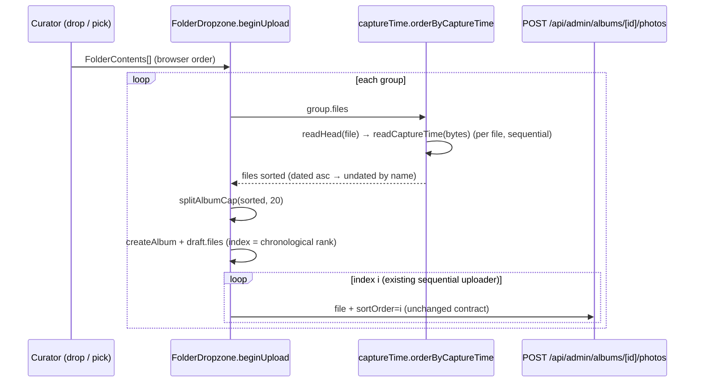

> [!NOTE]
> This document specifies **technical system architecture only** (data flow, storage, APIs, concurrency, state synchronization, and security).
> All visual, aesthetic, and UI design decisions (colors, typography, component styling, responsive layout) must be defined in `design.md`.

## Context

`FolderDropzone.beginUpload` (`src/components/admin/FolderDropzone.tsx:383+`) receives `FolderContents[]` groups, one per leaf folder, or a single flat group from the file input. For each group it does the following:

1. Runs `splitAlbumCap(group.files, 20)`.
2. Calls `createAlbum`.
3. Builds `draft.files` in list order.
4. Uploads the files sequentially, passing each file's **index** as `sortOrder`.

The list order is whatever the browser returned (research: Verified facts). The server honours `sortOrder` (`route.ts:127-133`). EXIF is gone by the time bytes leave the client in two cases: when the compressor re-encodes them (above 4.0 MiB), and always after the server's `sanitizeImage`. So capture time can only be read from the original `File`, on the client, before `prepareUploadFile` runs.

## System Architecture Diagram

## Goals / Non-Goals

**Goals:**
- A new album's initial `sortOrder` is its chronological capture-time rank. This is deterministic for a given set of files.
- No server, schema or API change, and no new dependency.
- Failure is silent and safe: an unreadable timestamp only changes a photo's position. It never blocks the upload.

**Non-Goals:**
- Re-sorting existing albums, or `+ Add Print` ordering.
- Persisting capture time, normalising time zones, or reading HEIC/AVIF (the Upload tab doesn't accept them).
- Pre-filling the album Date field from EXIF.

## Technical Decisions

**D1: A pure module, `src/components/admin/captureTime.ts`.**
- **Exports:**
  - `readCaptureTime(bytes: Uint8Array): CaptureTime | null` takes header bytes and returns `{ key: string; subSec: number }`. The `key` is the 14-digit `YYYYMMDDHHMMSS` string, which sorts correctly as plain text.
  - `compareCapture(a, b)`.
  - `orderByCaptureTime<T extends { name: string }>(items: readonly T[], readBytes: (item: T) => Promise<Uint8Array>): Promise<T[]>`.
- **Why this shape:** the reader is injected (the same pattern as `folderReader.ts`'s `DataTransferItemLike`), so ordering is unit-testable in the Node Vitest environment with byte fixtures and no DOM.
- **Alternative rejected:** putting the logic inline in `FolderDropzone`. It would only be testable through a browser.

**D2: Container walk, then one shared TIFF reader.**
- **JPEG:** walk the markers from `SOI`. Find the first `APP1` whose payload starts with `Exif\0\0`, and stop at `SOS`/`EOI`.
- **PNG:** walk the chunks after the 8-byte signature. Take `eXIf` (a raw TIFF stream with no prefix), and stop at `IDAT`.
- **WebP:** check `RIFF…WEBP`, then walk the chunks and take `EXIF`. Some writers prepend `Exif\0\0`; tolerate it.
- **TIFF:** read the byte order (`II`/`MM`) and check the magic `42`. In IFD0, read `0x0132` and follow `0x8769` to the Exif IFD. There, read `0x9003`, `0x9004` and `0x9291`. ASCII values longer than 4 bytes are read via their offset.
- **Bounds checks:** every offset is checked against the buffer length. Any out-of-range read returns `null` instead of throwing.
- **Why hand-written:** this repo already does the same IFD walk in `sanitizeImage.ts:180` (`parseExifOrientation`). That's a server module with private helpers, so we copy the approach, not the import.
- **Alternative rejected:** `exifr` (research: Candidate tech).

**D3: Read budget.**
- **JPEG and PNG:** `file.slice(0, 256 * 1024).arrayBuffer()`. JPEG `APP1` is capped at 64 KiB by the format and sits first in practice.
- **WebP:** `file.arrayBuffer()` in full, because its `EXIF` chunk trails the bitstream. That's bounded by the 20-file cap and the 25 MB server limit, and the reads are sequential, so at most one buffer is alive at a time.
- **Type detection:** sniff the magic bytes, not the extension or MIME type. That matches the server's behaviour.
- **Alternative rejected:** reading every file in full. A 20 × 25 MB JPEG folder would mean roughly 500 MB of pointless I/O.

**D4: Compare local wall-clock time, and ignore `OffsetTimeOriginal`.**
- **Why:** `DateTimeOriginal` is local camera time. Many cameras omit the offset, and phones include it. Normalising only the files that have an offset would mix UTC and local keys in one sort and could put photos in nonsense order.
- **What it handles:** the common case, one trip shot on one or two devices set to local time.
- **Accepted miss:** an album mixing devices set to different time zones (see Risks).

**D5: Comparator, total and stable.**
1. Dated before undated.
2. `key` ascending.
3. `subSec` ascending, parsed as `Number('0.' + digits)` (missing counts as `0`).
4. Natural filename order via `Intl.Collator(undefined, { numeric: true, sensitivity: 'base' })`.
5. The original list index, as the last tie-break, so equal names (from different subfolders flattened into one group) stay deterministic.

`Array.prototype.sort` is stable in every supported engine, but the explicit index tie-break makes that property independent of the engine anyway.

**D6: Wire it in at `beginUpload`, before `splitAlbumCap`.**
- `const ordered = await orderByCaptureTime(group.files, readCaptureBytes)`, then `splitAlbumCap(ordered, MAX_PHOTOS_PER_ALBUM)`. Nothing else changes: `draft.files` indices, `photoId`s, retries, and `uploadPhoto(…, index, …)`.
- Sorting before the cap makes the overflow notice deterministic: the 20 earliest photos are kept.
- `readCaptureBytes` lives in `FolderDropzone` (or alongside it in `captureTime.ts` as a browser-only adapter). It sniffs the first 12 bytes to choose between a slice read and a full read.
- Any rejection from `readBytes` (for example a `NotReadableError` on a file that disappeared) is caught per file and treated as undated.
- **Alternative rejected:** sorting `draft.files` after `createAlbum`. The cap would already have dropped arbitrary files.

**D7: The server stays as it is.**
- The existing `sortOrder` field already carries the rank.
- **Alternative rejected:** a `takenAt` form field plus server-side ordering. Uploads arrive one at a time and can be retried out of sequence, so the server would need a renumbering pass. It would also need a schema migration on the shared production Turso database.

## Risks / Trade-offs

- **[Risk]** The album mixes devices in different time zones, for example a phone on home time and a camera on local time, so the interleaving is off by the zone difference. → **Mitigation:** documented. The curator fixes it with the existing drag reorder. If it comes up in practice, we can do offset normalisation later, applied only when *every* dated file in the group has an offset.
- **[Risk]** The camera clock was never set, so the timestamps are wrong but valid. → Not detectable. The order is still internally consistent for a single camera.
- **[Risk]** Edited exports (Lightroom, Photos) rewrite `DateTime` but keep `DateTimeOriginal`. → `DateTimeOriginal` is preferred for exactly this reason.
- **[Risk]** Pre-upload latency for large WebP folders (D3). → Bounded by the 20-file cap and the sequential reads. It's measured in the manual verification.
- **[Trade-off]** For files with no capture time, filename order replaces browser order. In practice that's what browsers mostly returned anyway, but now it's deterministic.

## Migration & Rollback Plan

- No data migration. Existing albums keep their stored `sortOrder`.
- Rollback means reverting the `beginUpload` wiring commit. `captureTime.ts` is inert without it.
- No env vars, no deploy ordering, and no shared-DB writes during development. Verification runs against local dev with `STORAGE_DRIVER=local` and a local DB, never the preview or production Turso database.
