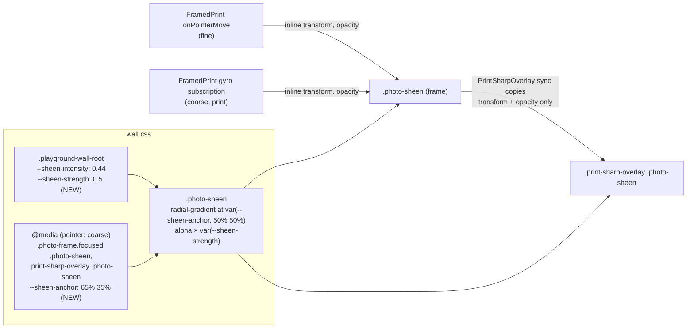

> [!NOTE]
> This document specifies **technical system architecture only** (data flow, storage, APIs, concurrency, state synchronization, and security).
> All visual, aesthetic, and UI design decisions (colors, typography, component styling, responsive layout) must be defined in `design.md`.

## Context

- The glare is a CSS-only layer. `.photo-sheen` (`wall.css` `L1147-L1163`) is an `inset: -65%` box with a centred `radial-gradient`. Its rest opacity comes from `--sheen-intensity` (`L437`).
- Two JS writers move it by setting inline `transform` and `opacity` on the sheen node: `FramedPrint`'s mouse hover (fine pointer) and its gyro subscription (coarse pointer, Print Focus only).
- `PrintSharpOverlay` mirrors only those two inline properties onto its own `.photo-sheen`. Everything else (gradient, blend, anchor) reaches the overlay through CSS selectors.
- The coarse-pointer profile at the end of `wall.css` already hides non-focused sheens and sets `mix-blend-mode: normal` on the focused and overlay sheens (`L1193-L1199`). `touchAudit.test.ts` audits those rules.

## System Architecture Diagram

## Goals / Non-Goals

**Goals:**
- Halve glare intensity on all pointers with a single tunable variable.
- Move the coarse-pointer resting position to the top-right without touching JS, so every input state is covered: gyro, Reduce Motion, permission denied, and devices without a sensor.
- Keep every non-sheen desktop computed style and pixel identical.

**Non-Goals:**
- No changes to gyro math, tilt amplitude, the mouse handler, `PrintSharpOverlay`, or the render-loop scheduler.
- No change to the desktop resting position.
- No resizing of the glare ellipse. That stays an open tuning knob (see research).
- No Album View change. The coarse Album View sheen stays hidden, and desktop Album View inherits only the intensity change.

## Technical Decisions

**D1: Scale the gradient's alpha stops, not the opacity.**
- Each non-zero stop becomes `rgba(…, calc(a * var(--sheen-strength)))`, with `--sheen-strength: 0.5` declared next to `--sheen-intensity` on `.playground-wall-root`.
- For a constant-colour white source, both the `screen` blend (desktop) and the `normal` blend (coarse) are linear in source alpha, so this is equivalent to multiplying the opacity by `0.5`. It holds at rest (`0.44`) and when active (`0.92`), and the falloff shape is unchanged.
- **Alternative rejected:** halve `--sheen-intensity` plus both inline `'0.92'` writes in `FramedPrint.tsx`. That's three edit sites across CSS and JS, and `lastSheenOpacity` caching and `PrintSharpOverlay` mirroring would carry the new literal around. Same visual result, more surface.

**D2: Anchor through a custom property with a centred fallback.**
- The base gradient becomes `radial-gradient(ellipse 46% 42% at var(--sheen-anchor, 50% 50%), …)`.
- The existing coarse rule selecting `.photo-frame.focused .photo-sheen, .print-sharp-overlay .photo-sheen` gains `--sheen-anchor: 65% 35%`.
- Fine pointers never set the variable, so the fallback resolves to exactly `50% 50%`. The only desktop computed-style change is then the alpha `calc()` from D1.
- Because the anchor lives in CSS, the inline `translate3d(-nx*38%, -ny*38%)` keeps operating as an offset from it, with no sign or amplitude change.
- **Alternative rejected:** bias `nx`/`ny` in the gyro callback. It doesn't cover the static no-gyro case (Reduce Motion or permission denied), which is exactly where the centred glare is most visible.

**D3: Reuse the existing coarse selector list.** Add the declaration to the rule that already pairs the focused-frame and overlay sheens. That keeps the frame and overlay in lockstep by construction, so the overlay can't rest in a different place from the frame it covers.

**D4: Guard with a static CSS audit.** A new `src/lib/__tests__/sheenGlareAudit.test.ts` reuses `touchAudit`'s rule-parsing approach to assert:
- the `calc(… * var(--sheen-strength))` stops;
- the single `--sheen-strength: 0.5` declaration;
- the `at var(--sheen-anchor, 50% 50%)` position;
- that `--sheen-anchor` appears only inside `(pointer: coarse)`.

`touchAudit.test.ts` stays unchanged and green.

## Risks / Trade-offs

- **[Risk]** `calc()` inside `rgba()` colour stops is unsupported in an old engine, which would drop the whole `background`, so no glare at all. → Every target (Safari 15+, Chrome, Firefox) supports it, and the Playwright parity run plus the device pass confirm the glare renders.
- **[Risk]** Desktop parity tooling flags every sheen state as a diff. → Recapture the baseline and assert that diffs are confined to `.photo-sheen` (computed `background-image` and the covered pixel regions).
- **[Trade-off]** At `65% 35%` the soft skirt of the ellipse still reaches about three-quarters of the photo width, so a faint falloff reaches the centre. → Accepted at `0.5` strength. `--sheen-size` is the follow-up knob if the device pass says it spills.
- **[Trade-off]** At full tilt toward the anchor, the glare slides partly off the photo. → Intended. It reads as the reflection leaving the glass.

## Migration & Rollback Plan

- CSS only: no data, API, env or dependency impact.
- To roll back, set `--sheen-strength: 1` (restores today's intensity) and/or delete the coarse `--sheen-anchor` declaration (restores the centred position). Each can be reverted independently.
- Verify on local dev (`STORAGE_DRIVER=local`). Device checks can run read-only against the preview.
