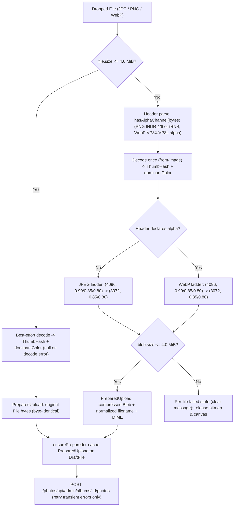

> [!NOTE]
> This document specifies **technical system architecture only** (data flow, storage, APIs, concurrency, state synchronization, and security).
> All visual, aesthetic, and UI design decisions (colors, typography, component styling, responsive layout) must be defined in `design.md`.

## Context

`POST /photos/api/admin/albums/[id]/photos` runs as a Vercel Serverless Function in production, where the platform enforces a `4.5 MB` maximum HTTP request body before application code executes. The route's own `MAX_UPLOAD_BYTES = 25 MB` check (`src/lib/upload/sanitizeImage.ts`) acts as defense in depth on self-hosted Node deployments, but real camera/iPhone JPEGs (`5–15 MB`) fail with a bare `HTTP 413` on Vercel. Meanwhile, the gallery wall requests at most `2048 px` on the long edge (`LOD_BUCKETS = [256, 800, 2048]` in `src/components/wall/zoomTier.ts`), resized by Bunny Optimizer from the stored object.

## System Architecture Diagram



## Goals / Non-Goals

**Goals:**
- Keep browser photo uploads within `4.0 MiB` (`CLIENT_MAX_UPLOAD_BYTES = 4 * 1024 * 1024`) so multipart requests succeed under Vercel's `4.5 MB` Function body cap.
- Leave files `<= 4.0 MiB` byte-identical—never failing a small file if client-side decoding throws or `createImageBitmap` is unavailable.
- Guarantee deterministic retry payloads via `ensurePrepared()` cached on `DraftFile` so `POST /api/admin/albums/[id]/photos` idempotency (`(photoId, sha256(rawBytes))`) never triggers `409 photo_id_conflict` on automatic or manual retries.
- Detect alpha channels deterministically from PNG/WebP binary headers (never via lossy downsampled pixel scanning) so transparent images are never silently flattened onto JPEG.
- Release decoded bitmaps and canvases deterministically and support clean client-side cancellation alongside server tombstone race protection.

**Non-Goals:**
- Changing the server upload route (`POST /api/admin/albums/[id]/photos`), DB schema, or `MAX_UPLOAD_BYTES = 25 MB`.
- Client-side HEIC decoding or video transcoding.
- Adding third-party compression libraries, WASM encoders, or Vercel Blob relays.
- Offloading compression to a Web Worker (deferred unless real-device profiling shows need).

## Technical Decisions

### D1. Dedicated pure-orchestration module (`src/components/admin/imageCompressor.ts`)
Extract upload preparation, binary header alpha detection (`hasAlphaChannel`), ladder stepping, filename normalization, retry caching (`ensurePrepared`), retryability classification (`isRetryableUploadError`), HTTP 413 formatting (`formatUploadHttpError`), and ThumbHash/dominant-color extraction into `src/components/admin/imageCompressor.ts` with injectable browser adapters (`decodeBitmap`, `encodeCanvas`, `readHeaderBytes`). Keeping browser APIs behind thin default adapters lets Vitest test every branch deterministically in Node/jsdom without mocking DOM globals.

### D2. Exact header-based alpha detection & single shared decode
1. **Small-file passthrough (`file.size <= CLIENT_MAX_UPLOAD_BYTES`):** Attempt to decode once via `createImageBitmap(file, { imageOrientation: 'from-image' })` to compute `thumbHash` and `dominantColor` on a `<= 32px` scratch canvas; close bitmap and zero scratch canvas in `finally`. If `createImageBitmap` is unavailable or throws, catch and return `{ blob: file, filename: file.name, contentType, thumbHash: null, dominantColor: null, compressed: false }` so small uploads never regress.
2. **Header alpha detection (`hasAlphaChannel(bytes)`):** For oversized files (`> 4.0 MiB`), read only the header bytes (no pixel allocation):
   - **PNG** (signature `89 50 4E 47 0D 0A 1A 0A`): read `IHDR` color type at byte 25 (`4` = grayscale+alpha, `6` = RGBA) → `true`; otherwise walk chunk headers before `IDAT` and return `true` if a `tRNS` chunk is present.
   - **WebP** (`RIFF....WEBP`): if first chunk is `VP8X`, check bit `0x10` of flags byte; if `VP8L`, check the alpha-is-used bit in the 4-byte packed header (bit 28).
   - **JPEG / everything else:** `false`.
   - *Rationale:* Conservative and exact—an RGBA screenshot with all opaque pixels takes the WebP path (lossy WebP at q0.9 is smaller than JPEG anyway), while a 1px transparent edge on a 4K PNG is guaranteed never to be missed by resampling. Eliminates any scan-canvas allocation.
3. **Oversized decode & ladder (`file.size > CLIENT_MAX_UPLOAD_BYTES`):**
   - Decode once with `createImageBitmap(file, { imageOrientation: 'from-image' })`, compute `thumbHash` and `dominantColor` from that same bitmap.
   - Target MIME: `image/webp` (`.webp`) if `hasAlphaChannel(bytes)` is `true`, otherwise `image/jpeg` (`.jpg`).
   - Step `COMPRESSION_LADDER = [{ maxEdge: 4096, quality: 0.9 }, { maxEdge: 4096, quality: 0.85 }, { maxEdge: 4096, quality: 0.8 }, { maxEdge: 3072, quality: 0.85 }, { maxEdge: 3072, quality: 0.8 }]`. Only re-draw the canvas when `maxEdge` changes (at most two draws: `4096`, then `3072`). Check `signal?.aborted` **between** decode and each encode step (note: `AbortSignal` cannot preempt an active `createImageBitmap` or `toBlob` call).
   - Stop at the first blob with `blob.size <= CLIENT_MAX_UPLOAD_BYTES` (and for WebP, verify `blob.type === 'image/webp'`; if Safari returns `image/png`, fail immediately with `"Transparent image could not be compressed under 4 MB in this browser. Try Chrome or export a smaller PNG."`).
   - Always close `bitmap` and zero `canvas.width = 0; canvas.height = 0` in `finally`.

### D3. Cached retry identity (`ensurePrepared`) & transient-only retries
Export a small pure seam in `imageCompressor.ts`:
```ts
export async function ensurePrepared(
  draft: { prepared: PreparedUpload | null; file: File },
  prepare: (file: File) => Promise<PreparedUpload>,
  store: (prepared: PreparedUpload) => void,
): Promise<PreparedUpload> {
  if (draft.prepared) return draft.prepared;
  const prepared = await prepare(draft.file);
  store(prepared);
  return prepared;
}
```
- `FolderDropzone.tsx` extends `DraftFile` with `prepared: PreparedUpload | null` and calls `ensurePrepared(...)` before the upload loop. Manual **Retry failed** clicks therefore reuse the exact cached `(blob, filename, contentType, thumbHash, dominantColor)` with the same `photoId`, guaranteeing identical `sha256(rawBytes)` on the server.
- `uploadPhoto` attaches HTTP status to thrown errors (`UploadHttpError`), and `isRetryableUploadError(error)` returns `true` **only** for `network_error`, `timeout`, and HTTP `5xx` (never re-uploading a 4 MB body on deterministic `400`, `409`, `413`, or `415`).

### D4. Best-effort Display-P3 with safe sRGB fallback
Acquire the 2D context with `try { ctx = canvas.getContext('2d', { colorSpace: 'display-p3' }); } catch {}` falling back to `canvas.getContext('2d')`. Display-P3 ICC retention in `toBlob('image/jpeg')` is treated as an empirical browser capability verified on Chromium and Safari, not a hard spec guarantee.

### D5. Client cancellation, server race safety, and platform-neutral `413`
- `FolderDropzone.tsx` keeps `abortControllersRef = useRef(new Map<string, AbortController>())` keyed by `albumId`. `discardDraft(albumId)` aborts the controller (stopping preparation between steps, aborting any active XHR via `xhr.abort()`, and preventing remaining draft files from starting) before calling `DELETE /photos/api/admin/albums/${albumId}`.
- **Late server-write race safety:** Aborting an XHR stops the browser from waiting, not a Serverless Function already executing. Existing server invariants handle this safely: `DELETE /api/admin/albums/[id]` marks `albums.status = 'deleting'` before storage purge; `POST /api/admin/albums/[id]/photos` rejects `album.status === 'deleting'` with `409 album_deleting` before any storage/DB write; and `purgeAlbumTombstone` runs recursive `deletePrefix('/albums/{albumId}/')` (re-run on startup by `src/instrumentation.ts` if any write slipped in).
- `formatUploadHttpError(status, responseText)` parses JSON `{ message, error }` when present; for bare/non-JSON `413`, returns the platform-neutral message `"Upload exceeded the server's request size limit. Try exporting a smaller copy."`.

## Risks / Trade-offs

- **[Risk] Safari does not encode `image/webp` in `canvas.toBlob`.** Safari returns `image/png`, so every oversized alpha-channel PNG/WebP hits the `blob.type !== 'image/webp'` guard and fails cleanly with the explicit message suggesting Chrome or a smaller PNG export. Acceptable trade-off vs. silently flattening transparency onto black JPEG.
- **[Risk] Mobile Safari memory ceiling on 48 MP photos (~192 MB RGBA + canvas + encoder).** → Mitigation: sequential one-file-at-a-time processing, immediate `bitmap.close()` and canvas zeroing in `finally`, and clean per-file error recovery. *Deferred optimization:* if the real-device iOS 48 MP check fails, read source dimensions from the binary header and decode directly via `createImageBitmap(file, { resizeWidth, resizeQuality: 'high', imageOrientation: 'from-image' })` so the 48 MP RGBA buffer is never allocated.
- **[Risk] EXIF double-rotation across browsers.** → Mitigation: `createImageBitmap(file, { imageOrientation: 'from-image' })` bakes orientation once and canvas output carries no EXIF; verified empirically with an Orientation-6 JPEG on Chromium and Safari.
- **[Risk] `AbortSignal` cannot preempt an active `createImageBitmap` / `toBlob` call.** → Mitigation: signal is checked immediately before and after decode and before each encode step; resources are still released in `finally`, and any late XHR write is bounded by server album tombstoning.

## Migration & Rollback Plan

Purely client-side change with zero database, API, or environment migrations. Rolling back reverts `FolderDropzone.tsx` and deletes `imageCompressor.ts` with no impact on previously uploaded photos.
