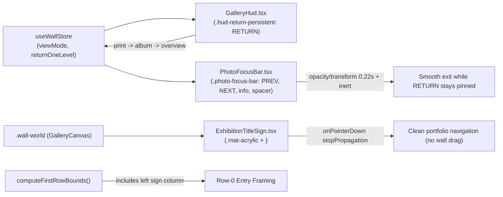

# Architecture: Exhibition Title Signage & Persistent Return HUD

> [!NOTE]
> This document specifies **technical system architecture only** (HUD state/transition ownership, `inert` accessibility, world-space coordinate placement, Row-0 framing bounds, and pointer-event isolation).
> Visual tokens, acrylic material styling, and animation curves are specified in `design.md`.

## Context

`GalleryHud.tsx` currently mounts a top-right `Overview` button, while `PhotoFocusBar.tsx` mounts `← PREV`, `NEXT →`, caption/metadata, and `RETURN [ESC]` and hard-unmounts when leaving `print` mode (`if (!visible) return null`). `useWallStore.returnOneLevel()` already implements the exact `print → album → overview` state machine. Inside `.wall-world`, albums are positioned via `worldXToCssLeft` / `worldYToCssTop` (`100px = 1 world unit`), and `computeFirstRowBounds` frames the initial Row-0 view.

## System Architecture Diagram

## Goals / Non-Goals

**Goals:**
- Single persistent `RETURN` button with zero pixel jump between `print` and `album` modes, smooth slide/fade transitions, and full keyboard/a11y safety (`inert` / `aria-hidden` when hidden).
- World-space `ExhibitionTitleSign` reusing existing `.mat-acrylic` + `.placard-standoff` CSS and mobile coarse-pointer frosted fallback (zero live `backdrop-filter` regression on mobile).
- Zero ungated `:hover` rules (keeping `touchAudit.test.ts` and `cssBoundaryAudit.test.ts` green).

**Non-Goals:**
- Changing `/photos/admin` Curator Studio chrome or `/admin/*` tab titles (which intentionally remain `"Chiaroscuro Gallery"`).
- Removing `Escape` or `0` keyboard shortcuts (they remain active in `GalleryCanvas.tsx`).
- Adding a dedicated WebGL spotlight for the title placard (beveled acrylic + mood-adaptive ink stays legible in the ambient left margin).

## Technical Decisions

### D1. Single Persistent `RETURN` in `GalleryHud.tsx` + Latched `PhotoFocusBar.tsx`
- **Decision:** Replace the top-right `Overview` button in `GalleryHud.tsx` with `.hud-return-persistent` (`RETURN`, plain label everywhere — reversing `mobile-print-transitions`'s `hud-key-hint` `[ESC]`), rendered in the DOM with `is-hidden` + `aria-hidden` + `disabled` + `tabIndex={-1}` when `viewMode === 'overview'`, calling `returnOneLevel()` on click. In `PhotoFocusBar.tsx`, remove `RETURN` and arrow glyphs (`←`/`→`), keep the bar mounted with `is-hidden` + boolean `inert` when `viewMode !== 'print'`, paint the last visible caption through the `0.22s` exit fade (the store retains `focusedAlbumId` on `print → album`), and place a matching `.photo-focus-return-spacer` on the right so `.photo-focus-info` stays centered while `.hud-return-persistent` sits at `z-index: 70` directly over the exact bottom-right slot.
- **Rationale:** One persistent button guarantees `0 px` shift when `.photo-focus-bar` slides/fades away on `Print Focus → Album View`, and the retained album prevents an empty white bar during exit.

### D2. Pure `includeTitleSign(bounds, placements)` Wrapper (`ExhibitionTitleSign.tsx`, `cameraMath.ts`)
- **Decision:** Keep `computeFirstRowBounds` **pure and unchanged**. Export the grid-locked 2 × 1 banner geometry — `TITLE_SIGN_WIDTH = 2 * PLACARD_WIDTH + GUTTER` (`4.52u` / `452px`), `TITLE_SIGN_HEIGHT = PLACARD_HEIGHT` (`2.0u` / `200px`) and `TITLE_SIGN_GAP = PLACARD_GAP` (`0.94u` / `94px`) — plus a pure helper `findTopLeftAlbum(placements)` (selecting the album with highest `y` / leftmost `x`, not blindly assuming `placements[0]`) and `includeTitleSign(bounds, placements)`:
  - Computes `placardLeft = firstLeft + ISLAND_PADDING` (the album placard's left edge, not the island edge) and `signLeft = placardLeft - TITLE_SIGN_GAP - TITLE_SIGN_WIDTH`.
  - Sets `newMinX = Math.min(bounds.x - bounds.width / 2, signLeft)`, keeps `maxX = bounds.x + bounds.width / 2`, and recomputes **both** `width = maxX - newMinX` and `x = (newMinX + maxX) / 2` so the union truly fits the banner rather than shifting without widening.
  - Called in `GalleryCanvas.tsx` when computing the entry Row-0 target; `<ExhibitionTitleSign />` mounts inside `.wall-world` with its top edge at the adjacent album placard's top (`islandTop - ISLAND_PADDING - PLACARD_TOP_OFFSET`), so top and bottom edges are flush.
- **Rationale:** Preserves every existing `cameraMath.test.ts` assertion, keeps proportions locked to the modular grid, and guarantees the banner fits on entry.

### D3. Native `GalleryCanvas` `onPointerDown` + `onClick` Isolation on `.exhibition-sign-column`
- **Decision:** Because `GalleryCanvas` attaches native `pointerdown`/`pointermove`/`pointerup` listeners directly to the wall element (running **before** React root delegation), add an explicit early return at the top of the **native** `onPointerDown` listener: `if ((event.target as HTMLElement | null)?.closest('.exhibition-sign-column')) return;`. Also add `.exhibition-sign-column` to `onClick`'s ignore list. Keep React `onPointerDown={(e) => e.stopPropagation()}` on `.exhibition-home-link` as belt-and-suspenders only.
- **Rationale:** Guarantees a click or drag starting on `← home` never enters `beginPointer`/`markGesture`, never pans the wall, and never triggers background `goOverview()`.

### D4. `:is(.museum-placard, .exhibition-title-placard).mat-aluminum` Selector Widening (`wall.css`)
- **Decision:** Reuse the existing Brushed Aluminum material for the title banner by widening every non-interactive `.museum-placard.mat-aluminum` base/text rule in `wall.css` (gradient face, bright bevels, dark `#161616`/`#141414` backing edges, shadow, title/caption/meta ink) to `:is(.museum-placard, .exhibition-title-placard).mat-aluminum` (same `0,3,0` specificity — zero desktop diff on album placards). Do **not** widen the album hover-lift rule (the banner is static signage) and do **not** add `.museum-placard` to the banner. Wrap `.exhibition-home-link:hover` inside `@media (hover: hover) and (pointer: fine)` (arrow shifts `-3px` left, subtle contrast shift, **no underline**). Add `@media (prefers-reduced-motion: reduce)` disabling transitions on `.photo-focus-bar`, `.hud-return-persistent`, and `.exhibition-home-link .home-arrow`.
- **Rationale:** Guarantees 1:1 material parity with the album placards' aluminium option (opaque silver face + dark core, legible outside the spotlights) with zero side-effects, while the banner retains its own grid-locked `452 × 200px` geometry.

## Risks / Trade-offs

- **[Risk] Including `TITLE_SIGN_WIDTH + TITLE_SIGN_GAP` (`5.46u`) in `computeFirstRowBounds` zooms Row-0 entry out further.** → **Mitigation:** The banner is grid-locked at `452px` and stays fully framed on desktop; on a `390×844` portrait phone the extra width drops entry scale from ~`0.27` to ~`0.217` (macro tier), which is verified explicitly and documented in `verification.md`.
- **[Risk] `PhotoFocusBar` staying mounted while hidden could interfere with `bottomInsetPx` measurement.** → **Mitigation:** Keep `useEffect` setting `setBottomInset(0)` whenever `!visible` (`viewMode !== 'print'`), measuring height only when `visible === true`.

## Migration & Rollback Plan

- Pure frontend UI/signage addition; rollback is a single `git revert`.
