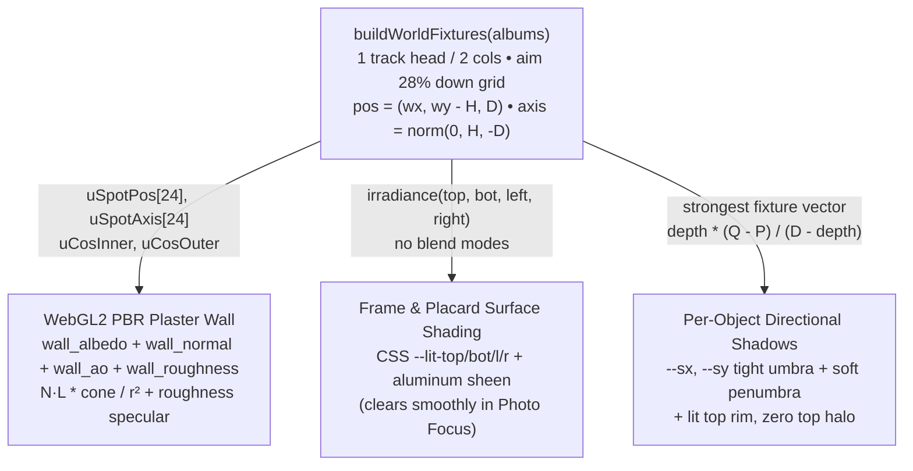

# Unified Gallery Lighting & Physical Realism Plan

## Goal Description

Unify all lighting across the **PBR plaster wall**, **framed prints**, **brushed-aluminum placards**, and **cast shadows** under a **single physical 3D overhead spotlight model**—first in the interactive playground ([photo_wall_playground.html](file:///home/node/global-sandbox/projects/photo-wall/playgrounds/photo_wall_playground.html)), and then carrying the exact same light geometry and shader math directly into the production **Next.js 16 + React Three Fiber v9** renderer.

---

## Feedback on the Two Proposals

### Proposal 1 (Top-Anchored CSS Beam + Surface Gradient → Three.js `SpotLight`)
- **Strong calls we are adopting**:
  - Protecting photo imagery from warm color tinting (use neutral/achromatic shading so photographic color stays faithful).
  - Keeping the top-edge highlight crisp and tightening cast shadows downward rather than using a uniform drop shadow.
  - Using real 3D lighting math in the production Three.js scene so stucco ridges, frames, and placards respond to one light.
- **What we should improve / avoid**:
  - **CSS beam gradients still decouple the scene**: Hand-tuning a CSS gradient on `.wing-light-pool` leaves the wall pool, frame shading, and cast shadows driven by three separate guesses.
  - **Production shadow-map warning**: Naive Three.js `SpotLight` with `castShadow = true` per album does **not** scale to 20–50 albums on an infinite wall (each shadow-casting spotlight adds a full shadow-map render pass). In production Three.js, we should compute **analytic spotlight irradiance + geometric SDF cast shadows** directly in the wall PBR shader and instanced frame shader (0 extra shadow-map passes, 60fps even with 50 albums).

### Proposal 2 (Single Physical Spotlight Model: `gallery-lighting.js` + `gallery-lighting.css`)
- **Strong calls we are adopting (Core Architecture)**:
  - **Single source of truth (`buildFixtures` + `rawIrradiance`)**: Placing 1 overhead track head per 2 grid columns aimed ~28% down the grid, and deriving **wall lighting, per-object top/bottom/left/right falloff, and per-object directional shadow offsets (`--sx`, `--sy`)** from the exact same 3D coordinates fixes the conflicting light directions and flat mats in one stroke.
  - **Turning down the screen-pinned vignette** (`.viewport-chiaroscuro-vignette` opacity `→ 0.28–0.35`) so light stays anchored to the albums on the wall instead of following the camera when panning.
  - **Directional cast shadow geometry**: Eliminates the dark halo on the top edge, introduces a light-proportional top rim highlight (`inset 0 1px 0`), and throws tight umbra + soft penumbra away from the strongest fixture (left frames throw shadows slightly left, right frames slightly right).
  - **Anisotropic brushed-aluminum placard sheen** driven by `--lit-top`.
  - **Walking `offsetParent` chain** to avoid Chrome's `preserve-3d` `.photo-cell` offset bug.
- **Four refinements we should make when merging Proposal 2**:
  1. **Skip the 2D `<canvas class="wing-light-canvas">` — drive our live WebGL2 PBR wall directly**: Proposal 2 was written before our WebGL2 PBR wall (`wall_albedo.webp`, `wall_normal.webp`, `wall_ao.webp`, `wall_roughness.webp`) landed. Rendering a 2D CPU light canvas per album would fight and wash out our WebGL2 normal-mapped plaster. Instead, we delete `.wing-light-pool` completely and feed the **exact world-space fixture positions & cone axes** (`uSpotPos[24]`, `uSpotAxis[24]`, `uCosInner`, `uCosOuter`) directly into `pbrWallCanvas`! That gives multi-head track-light scalloping **and** real per-pixel normal-mapped stucco highlights + roughness specular from the exact same lights that shade the frames and throw their shadows.
  2. **Steeper Grazing Angle for Stucco Relief**: Proposal 2 uses `heightFrac: 0.95, throwFrac: 1.05` (~42°). Setting `heightFrac: 0.98, throwFrac: 0.72` (~54° grazing angle closer to the wall) makes `wall_normal.webp` ridges catch noticeably crisper overhead highlights and micro-shadows. We will also expose a **Light Grazing Distance** slider so you can tune relief live.
  3. **Don't Over-Dim Focused Prints or Placard Readability**:
     - On `.photo-frame.focused`, smoothly lift the shading overlay (`opacity: 0`) so inspecting a print shows its true exposure without dimming.
     - Use a slightly gentler attenuation on `.museum-placard` (`0.38` max dark overlay instead of `0.55`) so the brushed aluminum reads as dim metallic silver at the beam edge rather than muddy flat gray.
  4. **Eliminate `MutationObserver` feedback loop**: Proposal 2 observes `document.documentElement` `style` mutations, which fires on every slider drag. Calling `updateLighting()` directly from `renderWall()` and relevant slider handlers is cleaner and avoids redundant DOM layout reads.

---

## Architecture: One Light Model Driving Both Wall & Objects



---

## Target Context Map

| Step | Relative File Path | Status | Target Lines | Exact Modifications |
| :--- | :--- | :--- | :--- | :--- |
| **1. Playground Unified Lighting** | `playgrounds/photo_wall_playground.html` | `[MODIFY]` | Lines `178–225` | Reduce `.viewport-chiaroscuro-vignette` opacity to `0.30`; remove `.wing-light-pool` completely (WebGL2 PBR wall handles all wall light cones). |
| | `playgrounds/photo_wall_playground.html` | `[MODIFY]` | Lines `255–420` | Add `.is-lit::after` directional surface shading overlay (achromatic, zero `mix-blend-mode`, `opacity: 0` when `.focused`), per-object `--sx`/`--sy` cast shadow rules for `.photo-frame.is-lit` (rest & hover) and `.museum-placard.is-lit`, and light-driven vertical anisotropic sheen on `.mat-aluminum.is-lit`. |
| | `playgrounds/photo_wall_playground.html` | `[MODIFY]` | Lines `985–1025` | Add **Light Grazing Distance (`throwFrac`)** slider (`0.45–1.35`, default `0.72`) in Section 4 so stucco bump relief and shadow length can be tuned interactively. |
| | `playgrounds/photo_wall_playground.html` | `[MODIFY]` | Lines `1170–1445` | Replace `pbrWall`'s single-ellipse-per-album shader with the exact multi-fixture cone + inverse-square + `N·L` + roughness specular shader (`N_SPOTS = 24`) driven by `buildWorldFixtures()`; remove `.wing-light-pool` DOM element in `renderWall()`; add `applyGalleryLighting()` walking `offsetParent` to set `--lit*`, `--sx`, `--sy` on every `.photo-frame` and `.museum-placard`. |
| | `playgrounds/photo_wall_playground.html` | `[MODIFY]` | Lines `2040–2135` | Wire the grazing-distance slider + export unified `lightingModel` (`fixturePerCols`, `hotspotFrac`, `heightFrac`, `throwFrac`, `innerDeg`, `outerDeg`) in the live JSON Config Exporter. |
| **2. Production Plan Sync** | `implementation_plan.md` *(Artifact)* | `[MODIFY]` | Renderer & Lighting sections | Document the shared `buildWorldFixtures` spotlight array feeding both the Three.js PBR `MeshStandardMaterial`/custom wall shader (`wall_albedo`, `wall_normal`, `wall_ao`, `wall_roughness`) and the `InstancedMesh` print shader (analytic irradiance + geometric SDF cast shadows, zero shadow-map overhead). |

---

## Proposed Changes

### 1. Shared Physical Fixture Model (`playgrounds/photo_wall_playground.html`)
- **Fixture placement per album**:
  - `n = Math.max(1, Math.ceil(album.cols / 2))` track heads distributed evenly across the photo grid width.
  - Hotspot `hy = gridTop + gridHeight * 0.28` (top-row bias, leaving the placard naturally at the soft outer edge of the beam).
  - Fixture 3D position in world coordinates: `pos = [worldHx, worldHy - H, D]`, where `H = gridHeight * 0.98`, `D = gridHeight * state.throwFrac` (default `0.72`).
  - Cone axis: `axis = normalize([0, H, -D])`, with `innerDeg = 16°`, `outerDeg = 32°`.
- **WebGL2 PBR Wall Shader (`pbrWallCanvas`)**:
  - Upgrades uniform array to `vec4 uSpotPos[24]` (`xyz` = world pos, `w` = `1 / peakNorm`) and `vec4 uSpotAxis[24]` (`xyz` = unit axis, `w` = unused).
  - Per pixel on the wall (`z = 0`):
    ```glsl
    vec3 L = uSpotPos[i].xyz - fragPos;
    float r = length(L);
    L /= max(r, 0.001);
    float cone = smoothstep(uCosOuter, uCosInner, dot(-L, uSpotAxis[i].xyz));
    if (cone <= 0.001) continue;
    float atten = cone / (r * r) * uSpotPos[i].w;
    float NdotL = max(dot(N, L), 0.0);
    // Roughness-driven micro-specular on plaster facets
    vec3 H = normalize(L + V);
    float shininess = mix(84.0, 8.0, rough * rough);
    float spec = pow(max(dot(N, H), 0.0), shininess) * (1.0 - rough * 0.72) * 0.34;
    color += (albedo * NdotL + vec3(spec)) * warmLamp * uSpotIntensity * atten * 1.45 * mix(1.0, ao, 0.75);
    ```
  - Result: Multi-head gallery scalloping at the top of each cluster, downward elliptical beam stretch, and crisp normal-mapped stucco ridges illuminated by the **exact same lights** casting the frame and placard shadows.
- **Per-Object Surface Falloff & Directional Shadows**:
  - Walk `offsetParent` up to `.album-island` to measure exact `(x0, y0, w, h)` of every `.photo-frame` and `.museum-placard`.
  - Evaluate `E(cx, y0)`, `E(cx, y0+h)`, `E(x0, cy)`, `E(x0+w, cy)` at standoff height `h = objDepth` and write `--lit`, `--lit-top`, `--lit-bot`, `--lit-l`, `--lit-r`.
  - Compute shadow vector from strongest fixture: `k = objDepth / (D - objDepth)`, `sx = (cx - fx) * k`, `sy = (cy - fy) * k`.
  - On `.photo-frame.focused`, fade `.is-lit::after` to `opacity: 0` so focused inspection is clean and unobstructed.

---

## Verification Plan

### Automated Check
- Validate playground JS syntax and verify no undefined symbols or console errors:
  ```bash
  node -e 'const fs=require("fs"),h=fs.readFileSync("/home/node/global-sandbox/projects/photo-wall/playgrounds/photo_wall_playground.html","utf8"); new Function(h.match(/<script>([\s\S]*?)<\/script>/)[1]); console.log("OK");'
  ```

### Visual / Manual Verification (Over Live Tunnel)
1. **Macro Overview**: Verify each album has a distinct, world-anchored multi-head scalloped light pool stretching downward from the top row, and panning the camera does **not** drag a bright circle across the wall.
2. **Album Focus**: Verify the top row of prints is visibly brighter than the bottom row, the brushed-aluminum placard sits gracefully at the outer edge of the beam with a top-lit metallic sheen, and left-side frames cast shadows slightly left while right-side frames cast slightly right—with zero dark halo above the top edge.
3. **Stucco Relief**: Drag the **Light Grazing Distance** and **Normal Bump Strength** sliders and verify `wall_normal.webp` ridges catch sharper highlights at lower `throwFrac`.
4. **Hover Tilt & Photo Focus**: Verify hover tilt, glass specular glare, wheel zoom-to-cursor, and unobstructed Photo Focus inspection (with full clean print exposure) all work smoothly.
