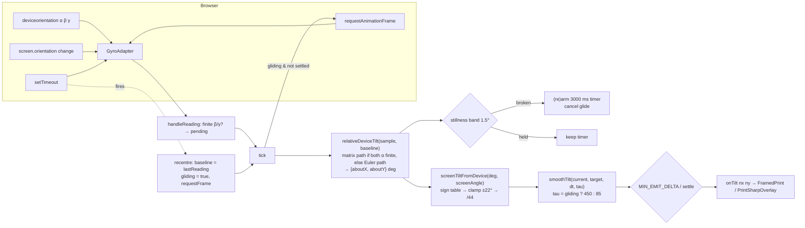

> [!NOTE]
> This document specifies **technical system architecture only** (data flow, storage, APIs, concurrency, state synchronization, and security).
> All visual, aesthetic, and UI design decisions (colors, typography, component styling, responsive layout) must be defined in `design.md`.

## Context

The coarse-pointer tilt pipeline is split in two:

- `gyroTilt.ts` holds the pure maths.
- `useGyroTilt.ts` holds the lifecycle: `createGyroController(adapter, onTilt)` plus a thin React hook.

`FramedPrint` and `PrintSharpOverlay` only ever see `{ nx, ny } ∈ [-0.5, 0.5]²` through `onTilt`.

Today the controller already captures an **entry baseline** (`useGyroTilt.ts:167`). The weakness is `computeGyroTilt`, which forms an **Euler delta** (`gyroTilt.ts:75-76`). That's wrong near `γ = ±90°` (landscape) and `β = ±90°` (upright portrait), and research.md shows a 15° landscape tilt turning into a corner slam.

Constraints:

- **Zero React state at sensor rate.** All writes go through `onTilt`.
- **Tests drive the real controller** through `GyroAdapter`, with no `window` and no real rAF.
- The W3C spec doesn't promise events while the device is stationary (research.md).
- Desktop and reduced-motion paths must stay byte-identical.

## System Architecture Diagram



## Goals / Non-Goals

**Goals:**
- Tilt is correct and continuous for any entry pose, including landscape and upright portrait, as long as the browser reports `alpha`.
- The behaviour is the same as today wherever Euler deltas were already correct, which is single-axis motion away from the singularities. That keeps every existing test green unchanged.
- Stillness-triggered recentre with a 450 ms glide that's independent of sensor event cadence.
- Everything new is deterministic under the fake adapter.

**Non-Goals:**
- Changing `FramedPrint`, `PrintSharpOverlay`, CSS, amplitudes (`±4°`, `38%`) or the sheen anchor.
- Absolute (compass) orientation, `deviceorientationabsolute`, `devicemotion`.
- Gyro in Album or macro tiers.
- Making the `alpha: null` fallback gimbal-safe. It stays on today's Euler maths.

## Technical Decisions

### D1: Relative rotation via 3×3 matrices, computed per tick

`gyroTilt.ts` gains:

```ts
export interface GyroSample { beta: number; gamma: number; alpha?: number | null }
export interface DeviceTilt { aboutX: number; aboutY: number } // degrees, unclamped

export function orientationMatrix(alpha: number, beta: number, gamma: number): Mat3; // Rz·Rx·Ry
export function relativeDeviceTilt(sample: GyroSample, baseline: GyroSample): DeviceTilt;
export function screenTiltFromDevice(tilt: DeviceTilt, screenAngleDeg: number): TiltVector;
```

- `relativeDeviceTilt` works like this:
  1. If both `alpha`s are finite, compute `R_rel = R_baseᵀ · R_cur`.
  2. Take only its third column, `v = R_rel·(0,0,1)`.
  3. Return `aboutY = atan2(v.x, v.z)·180/π` and `aboutX = atan2(−v.y, v.z)·180/π`.
  4. Otherwise return `{ aboutX: wrapAngleDelta(Δβ), aboutY: wrapAngleDelta(Δγ) }`, which is today's maths exactly.
- `screenTiltFromDevice` is today's `switch` with `dGamma → aboutY` and `dBeta → aboutX`, plus the clamp and `/44`, including `noNegativeZero`.
- `computeGyroTilt(sample, baseline, angle)` keeps its signature and becomes `screenTiltFromDevice(relativeDeviceTilt(sample, baseline), angle)`. Because the current tests pass no `alpha`, they exercise the fallback, which equals the old code. The new matrix tests show the two paths agree on single-axis motion.
- **Why not cache `R_base`:** the third column of `R_baseᵀ·R_cur` is about 30 multiply-adds with both matrices built inline. Caching adds mutable state to a pure function for no measurable gain.
- **Alternatives considered:** quaternions (same result, more code); gravity vector from `devicemotion` (noisy, blind to yaw, and a second iOS permission); `RelativeOrientationSensor` (no Safari). See research.md, Candidate tech.

### D2: The `alpha`-null fallback is per pair, not per session

The matrix path is used only when **both** the baseline and the sample carry a finite `alpha`. If not, the Euler path is used.

Forcing `alpha = 0` was ruled out. At a crossing it gives `aboutY ≈ −169°` (research.md), which is worse than today.

A mixed pair, where the baseline has `alpha` and the sample doesn't, uses the Euler path for that tick. That's a theoretical discontinuity on devices that drop `alpha` intermittently. It's accepted because no such device is known, and the next recentre or reset re-aligns things.

### D3: Stillness timer through the adapter, not through event arrival

`GyroAdapter` gains two methods:

```ts
setTimer(callback: () => void, ms: number): number;
clearTimer(handle: number): void;
```

Production wires them to `window.setTimeout`/`clearTimeout`.

Controller state additions:
- `lastReading: GyroSample | null`, the last valid reading processed in `tick`;
- `stillAnchor: DeviceTilt | null`;
- `stillTimer: number | null`;
- `gliding: boolean`.

The flow:

1. **In `tick`**, after computing `deg = relativeDeviceTilt(reading, baseline)`:
   - If `stillAnchor === null`, or either `|deg.aboutX − stillAnchor.aboutX|` or `|deg.aboutY − stillAnchor.aboutY|` exceeds `RECENTER_STILL_BAND_DEG` (1.5):
     - set `stillAnchor = deg`;
     - restart the timer at `RECENTER_STILL_MS` (3000);
     - set `gliding = false`.
   - Otherwise leave the timer running. If it already fired, it stays disarmed until the band is broken.
   - The band is measured in **unclamped** degrees. A pose held beyond ±22° still counts as still, so it recentres. Measuring after the clamp would make every saturated pose look still even while it's moving.
2. **When the timer fires** (guarded by `!disposed && listening && lastReading`):
   - set `baseline = lastReading`;
   - set `stillAnchor = { aboutX: 0, aboutY: 0 }`, because the new baseline is the reference;
   - clear `stillTimer` without re-arming it;
   - set `gliding = true`;
   - set `pending = lastReading` and `requestFrame(tick)` if no frame is queued.
   - `current` and `lastEmitted` are **not** touched, so the motion starts from where the print visibly is.
3. **Smoothing in `tick`** uses `smoothTilt(current, target, dtMs, gliding ? RECENTER_GLIDE_TAU_MS : DEFAULT_GYRO_TAU_MS)`.
   - **While gliding:** if `max(|current − target|) < GLIDE_SETTLE_EPS` (0.002), set `current = target`, emit it unconditionally (the final settle bypasses `MIN_EMIT_DELTA`), set `gliding = false` and stop. If not settled, and no sensor reading is already pending, set `pending = lastReading` and `requestFrame(tick)`.
   - **Glide and `dtMs`:** `dtMs` stays clamped at 100 ms by `smoothTilt`. The first glide frame after a long quiet period uses `lastTickAt` from the last sensor tick, so its `dt` clamps at 100 ms (alpha ≈ 0.2). That's a soft start, which is acceptable.
   - **Ordering:** the stillness check runs before smoothing. A band break therefore switches back to the tracking tau on that same tick.
4. **`reset()`** additionally clears the timer and sets `stillAnchor = null`, `gliding = false`, `lastReading = null`. `detach()` and `destroy()` clear the timer as well. `cancelPending()` already cancels the rAF.

**Alternatives considered:**

- **Measuring stillness from `adapter.now()` inside `tick`:** rejected. The W3C spec only fires on significant change, so a truly still phone may never tick and would never recentre.
- **A `setInterval` poll:** rejected as wasted wakeups.
- **Glide as a CSS transition on `.photo-frame`:** rejected. It would fight the inline transform writes and the overlay mirror, and break the "writes only through `onTilt`" contract.

### D4: Constants live in `gyroTilt.ts` next to the existing ones

`RECENTER_STILL_MS = 3000`, `RECENTER_STILL_BAND_DEG = 1.5`, `RECENTER_GLIDE_TAU_MS = 450` and `GLIDE_SETTLE_EPS = 0.002` are exported, so tests and a future device-tuning pass refer to one source. There's no runtime configuration.

### D5: The reading shape and the adapter

- `GyroReading` becomes `{ alpha?: number | null; beta: number | null; gamma: number | null }`.
- `isFiniteReading` still checks only `beta`/`gamma`.
- `handleReading` copies `alpha` when finite, and stores `null` otherwise.
- `createDefaultGyroAdapter().subscribeOrientation` forwards `event.alpha`.
- The existing test fake adapter gains `setTimer`/`clearTimer` backed by a manual queue (`advanceTimers(ms)`). This is the only edit to the existing test helpers.

## Risks / Trade-offs

- **[A device reports `alpha: null`]** → The Euler fallback keeps today's behaviour. No regression, but no landscape fix on that device. The device pass logs `alpha` to confirm.
- **[Natural hand sway exceeds 1.5° in 3 s, so it never recentres]** → The constant is exported and tuned in the device pass. Failing to recentre degrades to today's behaviour, never worse.
- **[A recentre while the visitor is deliberately holding an angle to study the glare]** → This is the intended trade-off, accepted in the proposal discussion. They have to be motionless within 1.5° for 3 s. Any nudge brings tracking back immediately.
- **[A glide rAF loop that never ends]** → It's bounded: exponential convergence reaches `0.002` from `0.5` in about 2.5 s, and context changes cancel it. A test asserts that frames stop after settling.
- **[Timer fires after detach]** → Guarded by `listening` and `disposed`, and cleared in `reset`/`detach`/`destroy`. Tested.
- **[Sign convention drift between the matrix and Euler paths]** → Single-axis equivalence tests pin both paths to the same signs, and the existing sign-table tests run unchanged.

## Migration & Rollback Plan

- This is client-only code with no data, schema or API impact. It ships with the normal Vercel deploy.
- **Rollback:** revert the PR. The pre-change maths is exactly the Euler fallback, so a partial rollback is also possible by forcing that path (`alpha` ignored), without touching the recentre.
- Verification is on local dev or read-only preview only, per the project's shared-DB constraint. Nothing here writes to Turso or Bunny.
