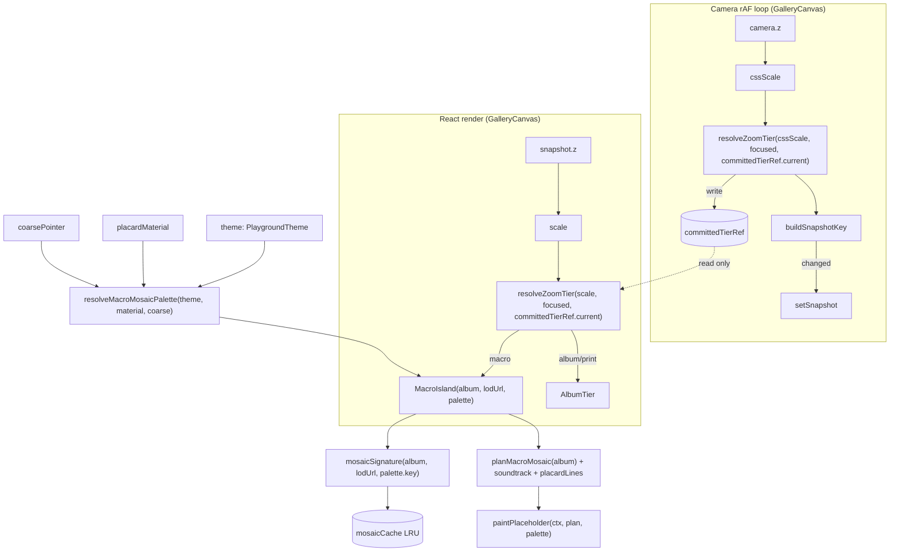

> [!NOTE]
> This document specifies **technical system architecture only**: data flow, state, purity boundaries and invalidation.
> Colours, bar geometry and visual rationale are in `design.md`.

## Context

The zoom tier decides whether each visible island is a `MacroIsland` canvas mosaic or a full `AlbumTier` DOM subtree (`GalleryCanvas.tsx:1009`). The tier comes from `resolveZoomTier(scale, printFocused)`, a single `scale < 0.25` comparison (`zoomTier.ts:88-91`), evaluated in two places:

1. **Render path** (`GalleryCanvas.tsx:358`): from `snapshot.z`, every React render.
2. **Camera rAF loop** (`GalleryCanvas.tsx:433-436`): from the live camera every frame. Its result goes into `buildSnapshotKey` (L446), and a key change calls `setSnapshot` (L470-471). That's the only way a mid-gesture tier change reaches React.

The mosaic (`MacroIsland.tsx:65-78`) paints a pale translucent placard rect and no soundtrack slot, so promote and demote change the placard column's colour and height in one frame (research.md, Verified facts).

**Constraints**
- The macro tier exists for performance (`dom-wall-engine/spike-results.md`). It must stay "mosaics only": no added DOM per island, no `backdrop-filter`, no thumbnails or iframes.
- The incremental-paint contract stays: placeholder painted once, then `O(N)` `drawImage`, true LRU, deferred disposal.
- Album and Print tiers must be pixel-identical to `b616dbc` at rest on desktop.

## System Architecture Diagram



## Goals / Non-Goals

**Goals**
- A deterministic Schmitt-trigger tier boundary: promote at `0.25`, demote below `0.22`.
- A single writer for the committed tier, so the render path and the camera loop can't disagree.
- A mosaic placeholder whose placard column has the same geometry and dominant colour as the detail tier.

**Non-goals**
- Any per-frame style write or animation (slice 3).
- Mounting both representations at once.
- Changing LOD bucket selection, which stays independent of the tier.
- Changing the `album`↔`print` decision, which still depends on focus only.
- Changing `TIER_STYLES`.

## Technical Decisions

### D1. Hysteresis lives in the pure tier function, with an optional `previous`

```
MACRO_PROMOTE_SCALE = 0.25   // = MACRO_SCALE_THRESHOLD (kept, re-exported)
MACRO_DEMOTE_SCALE  = 0.22

resolveZoomTier(scale, printFocused = false, previous?: ZoomTier):
  if !isFinite(scale)                                   -> 'macro'
  wasMacro = previous === undefined ? undefined : previous === 'macro'
  macro =
    wasMacro === undefined ? scale < MACRO_PROMOTE_SCALE   // today's behaviour
    : wasMacro             ? scale < MACRO_PROMOTE_SCALE   // stay macro until 0.25
    :                        scale < MACRO_DEMOTE_SCALE    // stay detailed until < 0.22
  macro ? 'macro' : printFocused ? 'print' : 'album'
```

- **Why `previous` is optional:** existing callers and the `zoomTier.test.ts:152-166` assertions keep their exact semantics. Only `GalleryCanvas` opts in.
- **Why hysteresis is on macro vs detail only:** `album` vs `print` is a focus decision, not a scale one. Passing `previous = 'print'` or `'album'` means "detail".
- **Why 0.22:** research.md, Superseded claims. A ~12% band covers pinch jitter while keeping the extra mounted islands at the demote point to `(0.25/0.22)² ≈ 1.29×`, against `1.42×` at 0.21.
- **Alternative rejected:** time-based debounce (research.md, Candidate tech).

### D2. One writer for the committed tier: the camera rAF loop

- `GalleryCanvas` adds `committedTierRef = useRef<ZoomTier | undefined>(undefined)`.
- **rAF loop (L433):** `const zoomTier = resolveZoomTier(cssScale, focused, committedTierRef.current); committedTierRef.current = zoomTier;`, then the existing snapshot key logic runs unchanged.
- **Render path (L358):** `const tier = resolveZoomTier(scale, focused, committedTierRef.current);`, reading only and never writing.
- **Why the render path agrees with the loop:** every camera-driven render follows a `setSnapshot` the loop issued in the same frame, after it updated the ref, so `scale` and `previous` refer to the same camera. A non-camera render reads the ref the last frame left, which is the committed tier at that `snapshot.z`.
- **Why the render path doesn't write:** under StrictMode or concurrent rendering, a render can run and be thrown away, so a write there would be a side effect during render. Before the first rAF frame the ref is `undefined`, so the render path uses today's rule.
- **Focus changes:** the loop reads `focusStateRef`, so the macro/detail decision isn't affected by focus. Only `album`/`print` labelling is, as today.
- **Alternative rejected:** putting `tier` into `CameraState` / `snapshot`. That widens a shared type and makes every snapshot consumer carry it.

### D3. The mosaic plan gains footprint geometry; it stays pure

- `MosaicPlan` gains `soundtrack: MosaicRect | null` (from `grid.soundtrack` through the existing `toBuffer` mapping) and `placardLines: MosaicRect[]`.
- The bar rects are defined in placard-local CSS pixels in `design.md`. They're converted with `pixelsPerUnit * WORLD_SCALE` relative to the placard rect's top-left.
- Caption bars are emitted only when `album.description?.trim()` is non-empty.
- **Why:** `planMacroMosaic` is already the shared geometry contract (`macroMosaic.ts` header). Keeping geometry pure keeps it table-testable with no canvas.

### D4. The palette is pure, theme-sourced and part of the cache signature

- `PlaygroundTheme` gains `macroPlate: { fine: [string, string, string]; coarse: [string, string, string] }`, the acrylic gradient stops at 0/55/100%.
  - chiaroscuro and concrete `fine` equal the base `.mat-acrylic` stops;
  - `coarse` equals their coarse rules;
  - alabaster has its alabaster stops in both.
- `resolveMacroMosaicPalette(theme, material, coarse): MacroMosaicPalette` returns:
  - the plate, either a three-stop gradient at 138° (acrylic) or a fixed aluminum or foamcore fill;
  - the edge highlights;
  - the ink colours;
  - the soundtrack slot colours;
  - `key`: a stable string of every colour value, so two palettes with the same output share a key.
- `mosaicSignature(album, lodUrl, paletteKey)` appends the key, and the signature also covers whether a description exists. A changed key goes through the existing "signature mismatch → delete, dispose (deferred if connected), rebuild" path in `mosaicFor`.
- **Where it lives:** the resolver lives in `macroMosaic.ts`, next to the plan, and is pure. The stops live in `playgroundTheme.ts`, the existing per-mood seam for placard glass ink.
- **Drift guard:** `src/lib/__tests__/macroPaletteAudit.test.ts` parses `wall.css` and asserts each theme's stops appear verbatim, whitespace-normalised, in the matching rule.
- **Alternatives rejected:** a DOM plate element and `getComputedStyle` (research.md, Candidate tech).

### D5. Plumbing

- `MacroIsland` gets one new prop, `palette: MacroMosaicPalette`.
- `GalleryCanvas` computes it once per render with `useMemo([theme, placardMaterial, coarsePointer])`. All three are already in scope (L156, L290, L263).
- No changes to `PhotoWallApp`, `CuratorStudio` or `PlaygroundGallery`.

### D6. Painting order inside `paintPlaceholder` (once per canvas)

1. `clearRect`.
2. Per cell: shadow, then mat (unchanged).
3. Placard: shadow, then plate, then edges, then bars.
4. Soundtrack slot, if present: shadow, then fill, then stroke.

Thumbnail `onload` still draws only its own cell, so the incremental contract and its `drawImage ≤ N` test hold. Paint calls added per canvas: at most 1 gradient plus about 10 `fillRect` / `strokeRect`.

## Risks / Trade-offs

- **Overview settles inside `[0.22, 0.25)`, so the resting tier depends on the direction of approach.**
  - Mitigation: task 1.1 measures Overview scale on the fixtures first.
  - If it lands in the band, record it in verification.md and flag it to the maintainer. Don't retune the Overview framing in this change.
- **More DOM at the demote point:** about 1.29× visible islands at `0.22` on `?demo=1000`.
  - Mitigation: measure the mounted-island count at `0.221` against `0.25` on `main` and record it. If an iPhone trace later shows a settle hitch over budget, narrow the band (0.23 gives `1.18×`).
- **Palette drift when someone retunes `wall.css` placard gradients.** Mitigation: the audit test fails on mismatch.
- **Mood change repaints all cached mosaics.** Rebuilds are lazy (only mounted islands call `mosaicFor`), and thumbnails come from the HTTP cache. This is a one-off cost per mood switch, which is rare.
- **The cover still pops at promote.** Accepted. The slot reserves footprint only; the content fade is slice 3.
- **Test fake context lacks `createLinearGradient`.**
  - Mitigation: extend the fake in `MacroIsland.test.tsx`, recording the gradient stops.
  - The painter must not crash when `createLinearGradient` is missing: fall back to the middle stop as a solid fill, so jsdom paths stay safe.

## Migration & Rollback Plan

- No data or API migration.
- Two independently revertible commits:
  1. hysteresis: `zoomTier.ts`, the `GalleryCanvas` ref and its tests;
  2. footprint and palette: `macroMosaic.ts`, `MacroIsland.tsx`, `playgroundTheme.ts`, the `GalleryCanvas` palette prop and their tests.
- Reverting commit 1 restores the single threshold. Reverting commit 2 restores the pale placeholder.
- Neither depends on the other's code.
