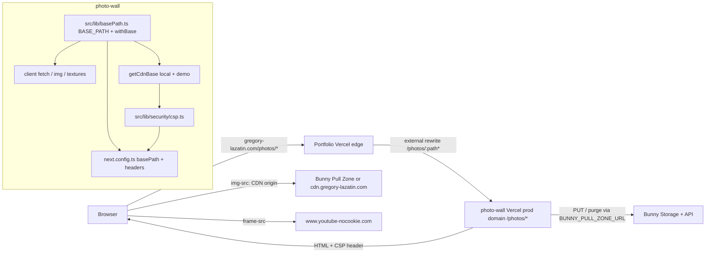

> [!NOTE]
> This document specifies **technical system architecture only** (data flow, storage, APIs, concurrency, state synchronization, and security).
> All visual, aesthetic, and UI design decisions (colors, typography, component styling, responsive layout) must be defined in `design.md`.

## Context

photo-wall currently assumes it owns the root of its origin. Once the portfolio proxies `gregory-lazatin.com/photos/*` to the photo-wall Vercel production domain, three things break:

1. **Path resolution.** Every client URL that starts with `/` resolves against `gregory-lazatin.com`, and the portfolio SPA answers it. That covers the manifest fetch, the admin fetches, the upload XHR, the WebGL textures, the YouTube thumbs, the `@font-face` sources and the `/demo` and `/api/local-uploads` image bases. `basePath` fixes `next/link`, the router and `/_next/*`, but none of these (research → External research).
2. **Security headers.** The portfolio's header rule excludes `/photos`, which is required because its CSP would block Next's inline scripts, Bunny and YouTube. That leaves photo-wall with no CSP at all, since it never shipped one.
3. **Auth.** The session cookie is `Path=/`, so the browser sends it on every portfolio request and a portfolio cookie with the same name could shadow it. The CSRF check only trusts hosts the request itself carries, and we don't yet know whether Vercel's external rewrite forwards `gregory-lazatin.com` as `x-forwarded-host`.

Separately, `getCdnBase()` reads `BUNNY_PULL_ZONE_URL` before `CDN_BASE_URL`, so the optional custom CDN hostname would never take effect.

## System Architecture Diagram



## Goals / Non-Goals

**Goals:**
- The app is fully functional under `/photos` both when proxied and when hit directly on its Vercel domain at `/photos`.
- One source of truth for the base path, and a lint-style test that keeps raw root-relative URLs from creeping back.
- A tight static CSP that matches what the app actually loads.
- A custom CDN hostname works through config alone.
- Admin login and mutations work through the proxy.

**Non-Goals:**
- Portfolio repo edits. The snippet below is documentation for that PR.
- Turso, the Vercel project, and the Bunny hostname, referrer and Optimizer settings.
- The upload size cap (plan options 1–3).
- Changing `getClientKey`. `TRUSTED_PROXY_HOPS` is a value to calibrate, not a code change.
- Nonce-based CSP.

## Technical Decisions

### D1. `BASE_PATH` is a hard-coded constant, not env
`src/lib/basePath.ts` exports `BASE_PATH = '/photos'` and `withBase()`. The module is dependency-free, so `next.config.ts` can import it by relative path (`./src/lib/basePath`) without the `@/` alias. We pick a constant over `NEXT_PUBLIC_BASE_PATH` because Next inlines `basePath` at build time anyway. A forgotten env var on Vercel would build a root-path app, and every proxied request would 404 with nothing pointing at the cause.

*Trade-off:* local dev now lives at `localhost:3000/photos`, and `/` 404s. That's acceptable, and it's also the most honest dev setup, since dev then matches production paths.

### D2. `withBase` semantics
```ts
export function withBase(path: string): string {
  if (!path.startsWith('/') || path.startsWith('//')) return path;   // absolute, data:, blob:, protocol-relative, relative
  if (path === BASE_PATH || path.startsWith(`${BASE_PATH}/`) || path.startsWith(`${BASE_PATH}?`)) return path;
  return `${BASE_PATH}${path}`;
}
```
The idempotence check matters because `getCdnBase()` already returns a prefixed local base, and `buildLodUrl` concatenates onto it. If someone later wraps a manifest URL in `withBase`, it must not become `/photos/photos/…`.

**Call sites**, re-grepped at implementation time:
- `useWallStore.ts`, `PhotoWallApp.tsx` (default `manifestUrl`), `useWallManifest.ts` (default `manifestUrl`), `SoundtrackPlaque.tsx` (thumb `src`), `PlaygroundPbrWall.tsx` (the `TEXTURES` map);
- `FolderDropzone.tsx` (4 fetches + XHR), `AdminDrawer.tsx` (4 fetches);
- `fakeManifest.ts` (`cdnBase`), `storage/index.ts` (`LOCAL_CDN_BASE`).

Wrap the **default values**, not the props. A caller passing `manifestUrl="/api/admin/wall-preview"` (the `admin-route-isolation` change) gets wrapped at the single `fetch(withBase(manifestUrl))` site inside `useWallManifest`. Idempotence makes double-wrapping harmless.

### D3. Fonts move into `src/app/fonts/` with relative `url()`
CSS `url('/fonts/x.woff2')` is a raw browser URL. Turbopack treats it as an external public path and leaves it as is. A relative `url('./fonts/x.woff2')` becomes a module reference: the bundler emits `/_next/static/media/x.<hash>.woff2`, and `basePath` applies to `/_next`. We pick this over `next/font/local` because it changes no typography declarations. The PATCH-01 Helvetica audit stays valid, and the font stack in `--font-family-base` is untouched. Delete `public/fonts/` once nothing references it.

### D4. Static CSP in `next.config.ts` `headers()`
`src/lib/security/csp.ts` exports `buildContentSecurityPolicy({ cdnOrigin, isDev })` and `cdnOriginFrom(base: string | undefined): string | null` (returns `new URL(base).origin`, or `null` for empty, root-relative or invalid input). `next.config.ts` computes the following at build:
```ts
const cdnOrigin = cdnOriginFrom(process.env.CDN_BASE_URL || process.env.BUNNY_PULL_ZONE_URL);
headers: async () => [{ source: '/:path*', headers: [{ key: 'Content-Security-Policy', value: buildContentSecurityPolicy({ cdnOrigin, isDev }) }] }]
```
`source` is auto-prefixed with `basePath`.

**Why static with `'unsafe-inline'`:** Next's App Router injects inline flight scripts. The only way to drop `'unsafe-inline'` is per-request nonces through `proxy.ts`, and nonces force every page dynamic, which throws away the `cacheComponents` static shell. A static policy still buys the parts that matter here:
- `object-src 'none'` and `base-uri 'self'`;
- `frame-src` locked to youtube-nocookie;
- `img-src` locked to self plus the CDN;
- `connect-src 'self'`, which is what keeps an injected script from exfiltrating to an arbitrary host.

**Build-time env dependency:** `headers()` is evaluated during `next build`, so `CDN_BASE_URL`/`BUNNY_PULL_ZONE_URL` must be present in the Vercel build environment. They are, since Vercel exposes project env to builds. Changing the CDN host needs a redeploy. Document this in the README deploy section.

**Clickjacking.** The portfolio's excluded header rule was the only thing that could have set framing protection, so the policy adds `frame-ancestors 'none'`. The same entry also adds `X-Frame-Options: DENY` for older browsers. Nothing legitimately frames photo-wall: the portfolio proxies it with a rewrite and never frames it in an iframe.

**YouTube IFrame API is deliberately blocked.** `FolderDropzone.captureDuration` calls `loadYouTubeIframeApi()`, which injects `<script src="https://www.youtube.com/iframe_api">` and then builds a 1×1 `www.youtube.com/embed` player to read `getDuration()`. Under `script-src 'self' 'unsafe-inline'`, the script load fails. `script.onerror` resolves `null`, and `captureDuration` returns early, so the curator still gets the server-side oEmbed artist and title guesses but no auto-filled duration. We accept that rather than allowing `https://www.youtube.com` in `script-src`. That would be a site-wide allowance for a host with a history of JSONP-style CSP bypasses, just to save the curator typing a number. Public playback is unaffected, because `SoundtrackPlaque` uses a plain `youtube-nocookie.com` iframe.

*Follow-up once `/admin` exists (`admin-route-isolation`):* scope a looser policy to the curator route only. Browsers enforce **every** CSP header a response carries (the intersection), so a second `headers()` entry for `/admin/:path*` cannot loosen the default one. The default entry's `source` must exclude admin, for example `'/((?!admin).*)'`, and `/admin/:path*` then gets its own policy that adds `https://www.youtube.com` to `script-src` and `frame-src`.

**Additional security headers.** Add these in the same `headers()` entry: `X-Content-Type-Options: nosniff` and `Referrer-Policy: strict-origin-when-cross-origin`. They're cheap, and they replace the portfolio headers we're excluding. Bunny referrer allow-lists need an origin-level `Referer`, and `strict-origin-when-cross-origin` sends `https://gregory-lazatin.com/` cross-origin, so hotlink protection keyed on the host still passes.

### D5. Public CDN base prefers `CDN_BASE_URL`
Flip the `??` order in `getCdnBase()` and treat an empty string as unset (`process.env.CDN_BASE_URL || process.env.BUNNY_PULL_ZONE_URL`). `BunnyStorageAdapter` keeps `pullZoneUrl` for `buildPurgeUrl` and `publicUrl`. `publicUrl` is only used server-side for diagnostics, so it stays on the pull zone. The CSP derives `cdnOrigin` from the same precedence, so the two can't disagree.

### D6. Cookie: `photowall_session`, `Path=${BASE_PATH}`
Rename `SESSION_COOKIE_NAME` and build `Path` from `BASE_PATH`. Both `sessionCookie()` and `clearedSessionCookie()` must use identical name and path, or logout silently fails: a `Path=/photos` clear doesn't remove a `Path=/` cookie. The rename means a stale `pw_admin_session; Path=/` cookie from local dev is simply ignored. It's harmless and expires on its own (7 days max-age). We skip any migration shim.

### D7. CSRF allow-list via `TRUSTED_ORIGIN_HOSTS`
`allowedHosts()` appends hosts parsed from `TRUSTED_ORIGIN_HOSTS`: split on `,`, trim, lower-case, drop empties. Hosts compare with ports included, matching the existing `new URL(origin).host` behaviour. The strict `Origin` rule is unchanged otherwise. An absent `Origin` is still allowed, which matches the current spec.

We add this explicit list rather than relying on `x-forwarded-host` because whether Vercel's external rewrite forwards the public host is unverified (research → Unverified assumptions). Even if it does, an explicit env list doesn't break when the proxy chain changes. Production sets `TRUSTED_ORIGIN_HOSTS=gregory-lazatin.com,www.gregory-lazatin.com`.

### D8. `TRUSTED_PROXY_HOPS` calibration (procedure, no code)
On the portfolio preview, temporarily log `x-forwarded-for` and `x-real-ip` from `GET /api/admin/auth` (then remove the log). Pick `hops` so that `parts[length - hops]` is the client's public IP, not the portfolio edge's egress IP. Don't leave `TRUSTED_PROXY_HOPS` unset to dodge the question. Unset makes `getClientKey` return `'direct'` for every request, so all visitors share one 5-attempt bucket and one stranger's typos lock the curator out. A value that's one too small is the same failure in disguise: every visitor keys on the portfolio's egress IP. Record the chosen value and the observed header shape in `verification.md`.

### D9. Portfolio-side snippet (documentation only)
```json
{
  "rewrites": [
    { "source": "/photos", "destination": "https://<photo-wall-prod-domain>/photos" },
    { "source": "/photos/:path*", "destination": "https://<photo-wall-prod-domain>/photos/:path*" }
    /* …existing SPA fallback stays LAST… */
  ],
  "headers": [
    { "source": "/((?!photos).*)", "headers": [ /* existing portfolio CSP etc. */ ] }
  ]
}
```
The destination keeps `/photos` because photo-wall itself serves under `basePath`. Point it at the production domain, not a deployment URL, so promotions don't need a portfolio redeploy.

### D10. Coordination with `admin-route-isolation`
That change adds `src/proxy.ts`, with matchers `'/admin'`, `'/api/admin/:path*'` and so on. Next auto-prefixes middleware/proxy matchers with `basePath`, so its matchers need no change. It also adds `AdminLoginForm` and `AdminWallApp`, each with its own fetches. If this change lands first, the `admin-route-isolation` implementer wraps those fetches in `withBase`. If that change lands first, this change's audit test (spec: "No raw root-relative client URLs remain") catches them, and it scans `src/app` for exactly this reason.

**Landing order: this change first.** That puts `withBase()` and the audit test on `main` before `admin-route-isolation` starts. That change then gets CI-enforced URL hygiene for free, and it can take on the admin-scoped CSP follow-up from D4.

## Risks / Trade-offs

- **[Risk] A missed raw URL works locally only by accident.** For example, a hard-coded `/api/…` in a newly added component. → Mitigation: the source-scan test in `tests.md` fails CI, and the Playwright run asserts no app-origin request falls outside `/photos/`.
- **[Risk] CSP blocks something we didn't enumerate.** Candidates are a `blob:` worker, a future analytics script, or Bunny's Optimizer redirecting to another host. → Mitigation: the manual check requires zero console CSP violations across wall load, print focus and soundtrack play. Adding an origin later is a one-line change in `csp.ts`.
- **[Risk] The CSP is frozen at build time.** A change to `CDN_BASE_URL` without a redeploy leaves images blocked. → Mitigation: document it. Vercel redeploys on env change anyway when you hit "Redeploy".
- **[Risk] Purge doesn't cover the custom hostname.** → Mitigation: the infra checklist includes an upload, delete and fetch on the custom host, and the result goes in `verification.md`. If it fails, add the custom hostname as a second purge target in a follow-up.
- **[Trade-off] `'unsafe-inline'` scripts.** The CSP does not stop inline-script XSS on its own. We accept this for the static shell, and the `connect-src` and `img-src` lockdown still limits exfiltration.
- **[Trade-off] Local dev URL changes to `/photos`.** Scratch Playwright scripts and bookmarks need updating.

## Migration & Rollback Plan

1. Land this change on `main` and deploy photo-wall. Verify directly at `https://<photo-wall-prod-domain>/photos` that the wall loads, there are no CSP violations, and login works.
2. Set `TRUSTED_ORIGIN_HOSTS` (and `CDN_BASE_URL` if you're using the custom hostname) in Vercel, then redeploy.
3. Open the portfolio PR with D9 and calibrate `TRUSTED_PROXY_HOPS` on its preview (D8).
4. Merge the portfolio PR.

**Rollback.** Revert the portfolio PR first: `/photos` returns to SPA 404, and photo-wall stays reachable on its own domain. Reverting this change alone, while the portfolio still proxies, breaks the proxied app, so always roll back in that order. No data migration is involved. Sessions reset once because of the cookie rename.
