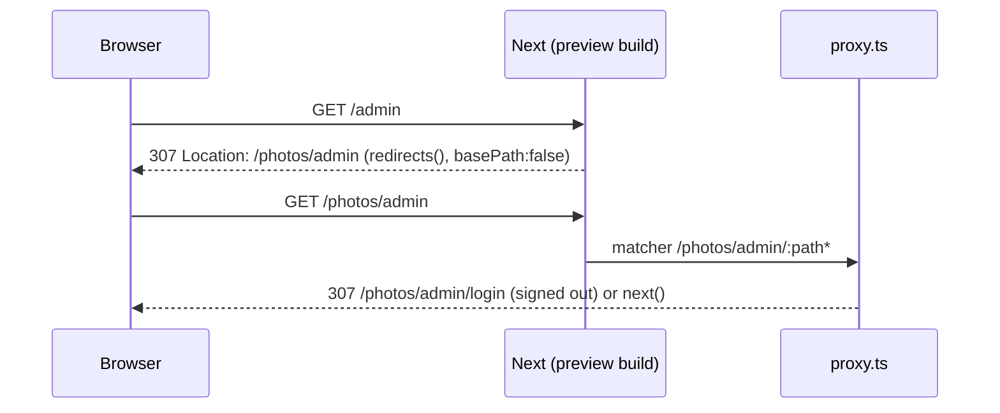

> [!NOTE]
> This document specifies **technical system architecture only**. Visual decisions belong in `design.md`, and this change has none.

## Context
`basePath: '/photos'` is baked in at build time so the portfolio can proxy `gregory-lazatin.com/photos/*`. Preview deploys are reached directly at `*.vercel.app`, where `/` and `/admin` hit nothing. `proxy.ts` gates the curator surface with a matcher that Next prefixes with the base path.

## System Architecture Diagram

## Goals / Non-Goals
**Goals:** the bare preview origin opens the wall, and `<preview>/admin*` lands on the gated admin page.
**Non-Goals:** changing `BASE_PATH` per environment, root rewrites, `/api/admin` at the root, and production root behaviour.

## Decisions
1. **Redirect, not rewrite.** Next's order is `headers` → `redirects` → proxy (middleware) → `beforeFiles` rewrites. A redirect turns `/admin` into a new `/photos/admin` request, which the proxy matcher sees. A rewrite would run after the proxy had already declined to match the unprefixed path, which bypasses auth. This is the load-bearing decision.
2. **`basePath: false` on each entry.** Without it, Next prefixes `source` with `/photos`, and the rule would only match `/photos/` paths.
3. **`307` (`permanent: false`).** Browsers cache `308`s. A cached root redirect would follow a preview hostname around after the config changes, and it must never leak into a production alias.
4. **Pure helper `previewRootRedirects(vercelEnv: string | undefined)`** in `src/lib/previewRedirects.ts`. It's dependency-free, like `basePath.ts`, because `next.config.ts` imports it by relative path before the `@/` alias exists. It builds destinations from `BASE_PATH`, which keeps the one-source-of-truth scenario green. `next.config.ts` calls `redirects: async () => previewRootRedirects(process.env.VERCEL_ENV)`.
5. **Build-time gating.** `redirects()` is evaluated at build, and Vercel sets `VERCEL_ENV` for builds. Production artifacts therefore contain no root redirects at all.

## Risks / Trade-offs
- If `VERCEL_ENV` is missing at build, redirects are silently absent and we're back to today's behaviour. That fails safe, not open. Task 3.3 confirms it on a real preview.
- The URL bar shows `/photos` after the redirect. That's intended: the preview then exercises the same paths as production.
- Promoting a preview deployment to production reuses its build, so the redirects would ship with it. Production traffic arrives via the portfolio at `/photos/*` and never hits `/` or `/admin`, so the rules are inert there. Note this in `verification.md`.

## Migration Plan
None. The change is additive config. Rollback is a revert.

## Open Questions
None.
