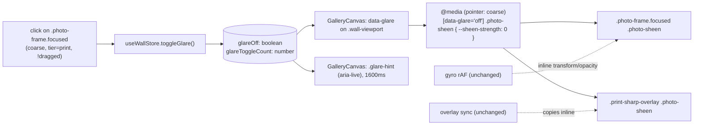

> [!NOTE]
> This document specifies **technical system architecture only**: state, event routing and the CSS seam.
> The hint's visuals are in `design.md`.

## Context

On coarse pointers the glare appears only in Print Focus. There, `FramedPrint`'s gyro subscription writes the sheen's inline `transform` and `opacity: 0.92` per frame (`FramedPrint.tsx:113-145`), and `PrintSharpOverlay` copies those inline values onto its own sheen every rAF (`PrintSharpOverlay.tsx:169-180`). Both sheens paint `radial-gradient` alpha stops scaled by `--sheen-strength` (`wall.css:1170-1171`).

The PR #18 postmortem (memory, and the `archive/mobile-print-transitions` tag) warns against blind edits to the Print Focus overlay, gyro and compositing paths. This design keeps all of them untouched.

## System Architecture Diagram



## Goals / Non-Goals

**Goals**
- A one-tap, session-scoped glare toggle on coarse pointers in Print Focus.
- Zero changes to the gyro loop, the overlay sync and desktop rendering.

**Non-goals**
- Persisting the toggle across reloads.
- A desktop toggle.
- Turning off tilt or shadow.
- A general toast system.

## Technical Decisions

### D1. State in `useWallStore`, session-only
- New fields:
  - `glareOff: boolean` (default `false`);
  - `glareToggleCount: number` (default `0`);
  - `toggleGlare()`, which flips `glareOff` and increments the count.
- There's no persistence middleware. The wall store doesn't persist anything today, and this doesn't change that.
- **Why the count:** it lets the hint fire on every toggle, including the same value twice across sessions of focus, and pick the first-time copy (`count === 1`), without a second flag.
- `resetWall` (`useWallStore.ts:~135`) SHALL NOT reset `glareOff`. The preference outlives manifest refreshes.

### D2. Event routing in `FramedPrint.onClick`
- The new branch sits after `stopPropagation`, the `wasDragged` guard and the macro / small-scale album-select branch:
  ```
  if (tier === 'print' && focused && isCoarsePointer()) {
    void requestGyroPermission?.();
    toggleGlare();
    return;
  }
  ```
- `toggleGlare` comes from `useWallStore` inside `FramedPrint`, as `useWallStore((s) => s.toggleGlare)`.
  - It's a stable function reference, so it causes no re-renders.
  - The alternative is a prop threaded through `AlbumTier`. Both are acceptable; the store selector keeps the `AlbumTier` props unchanged.
- **Why `focused`, not `classList.contains('focused')`:** `focused` is the React prop that's already in scope, and it's authoritative.
- **Neighbour prints** (`!focused`) fall through to `onSelectPhoto`, unchanged.

### D3. CSS seam: `data-glare` on `.wall-viewport` and a zeroed `--sheen-strength`
- `GalleryCanvas` adds `data-glare={glareOff ? 'off' : undefined}` to the `ref={containerRef}` div (`GalleryCanvas.tsx:1019-1023`), next to `data-tier`.
- It subscribes with `useWallStore((s) => s.glareOff)`, a boolean, so it re-renders only when toggled.
- The `wall.css` rule goes inside the existing coarse `@media` block, after the rule at `wall.css:1211-1215`:
  ```
  .playground-wall-root [data-glare='off'] .photo-sheen { --sheen-strength: 0; }
  ```
- **Why this works over the inline writes:** the gyro writes `opacity` and `transform` inline, but the gradient's alpha is `calc(0.38 * var(--sheen-strength))`. A custom property declared on the sheen element itself wins over the value inherited from `.playground-wall-root`, so the inline opacity multiplies a fully transparent gradient.
- **Why not `display: none`:** it would break the overlay's cached sheen refs. See research.md, Candidate tech.

### D4. The hint
- `GalleryCanvas` holds local state: `hint: string | null`.
- An effect on `glareToggleCount` (skipping `0`) sets the text:
  - `count === 1` and `glareOff`: `Glare off · tap photo to restore`;
  - otherwise `Glare off` or `Glare on`.
- A `1600 ms` timeout clears it. Each new toggle clears the previous timeout.
- The element is a sibling of `.wall-world` inside `.wall-viewport`, so it isn't scaled by the camera:
  - `<div className="glare-hint" role="status" aria-live="polite">`;
  - it's always rendered, with empty text when idle, so screen readers pick up the change;
  - `pointer-events: none`.

## Risks / Trade-offs

- **[A WebKit repaint or compositing artefact when a custom property flips under a transformed, composited overlay]** → The change is CSS-only, with no new layers and no `backdrop-filter`. Verify on an iPhone first (tests.md, Manual Verification). Rollback is one commit.
- **[Accidental toggles when a visitor taps to "go back"]** → Taps on the wall still return one level, and only taps on the focused print toggle. The hint makes an accidental toggle obvious and reversible.
- **[`requestGyroPermission` now runs on a toggle tap]** → It's session-memoized (`useGyroTilt`), so it's a no-op after the first call.

## Migration & Rollback Plan

- No data migration.
- One commit for behaviour and CSS, one for tests. Reverting removes the attribute and the rule.
