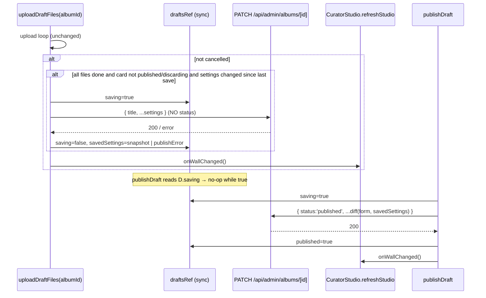

> [!NOTE]
> This document specifies **technical system architecture only**: client state, request sequencing and the refresh wiring.
> The card label copy is in `design.md`.

## Context

`FolderDropzone` creates each album with `POST /api/admin/albums`, which makes it a server-side draft (`repository.ts:273`). It then uploads the files sequentially in `uploadDraftFiles` (`FolderDropzone.tsx:264-346`).

The optional settings form (`settingsRef`) is written to the server only by `publishDraft` (`L348-365`), which sends the whole form plus `status: 'published'` and then refreshes the **public** wall. `discardDraft` (`L367-382`) refreshes nothing.

`CuratorStudio` owns the draft-aware preview (`manifest`) and the Exhibitions list (`loadAdminAlbums`), but passes no callback into `FolderDropzone` (`CuratorStudio.tsx:657`).

## System Architecture Diagram

## Goals / Non-Goals

**Goals**
- The draft and its metadata are visible in the Studio as soon as an upload completes.
- No request can ever demote a published album.
- Publish never overwrites Exhibitions edits.
- No API change.

**Non-goals**
- Server-side metadata capture.
- A "Save draft" button.
- Changing the upload loop, compression, retries or abort semantics.
- Per-card settings forms.

## Technical Decisions

### D1. The auto-save omits `status`
- `buildAlbumPatchBody(title, settings, { publish: boolean, since: OptionalSettings | null, titleSince: string | null })` is pure and exported.
- With `publish: false` it never emits `status`. With `publish: true` it emits `status: 'published'`.
- **Field selection.** When `since` is non-null, it emits only the fields whose value differs from `since`. When `since` is null, it emits all of them, as today.
  - The mapping is unchanged: `cameraName`, `dateLabel`, `locationLabel`, `soundtrackArtist`, `soundtrackTitle`, `soundtrackDurationSec`, and `youtubeVideoId` when `videoId` is truthy.
  - When `videoId` changed to `null` since the last save, it emits `youtubeVideoId: null`, which the route treats as clearing the soundtrack.
- `title` is emitted when `titleSince` is null or differs.
- **Alternative rejected:** `status: 'draft'` (research.md, Candidate tech).

### D2. Card state
`Draft` gains three fields:
- `saving: boolean`;
- `savedSettings: OptionalSettings | null`;
- `discarding: boolean`.

Auto-save and publish errors both use the existing `publishError` field, since the card shows one error line. All three new fields are initialised in `beginUpload` (`L414-431`).

### D3. Sequencing and guards
- **End of `uploadDraftFiles`,** after the existing controller cleanup (`L342-345`) and only if the run wasn't aborted:
  1. Re-read the card from `draftsRef`.
  2. Run the auto-save when all of these hold:
     - every file is `done`;
     - `!published`;
     - `!discarding`;
     - `!saving`;
     - the settings or title differ from `savedSettings`, or `savedSettings === null`.

     The auto-save is `saveDraftMetadata(albumId)`: it sets `saving: true`, sends `PATCH buildAlbumPatchBody(title, settingsRef.current, { publish: false, since: null })`, and on success stores `savedSettings` as a copy of the snapshot that was sent.
  3. Then, auto-save or not, `await notifyWallChanged()`.
- **Late results:** after the auto-save's `await`, if the card is gone or `discarding`, return without touching state.
- **`publishDraft`:**
  - It returns immediately if `draftsRef` shows `saving`, `published` or not-all-done.
  - Otherwise it sets `saving: true`, sends `buildAlbumPatchBody(title, settingsRef.current, { publish: true, since: card.savedSettings, titleSince: card.savedSettings ? card.title : null })`, and on success sets `published: true`.
  - It then calls `notifyWallChanged()`. `saving` is cleared in a `finally`.
- **`discardDraft`:**
  - It sets `discarding: true` first, then keeps the existing abort-and-DELETE behaviour.
  - It removes the card and calls `notifyWallChanged()`.
- **`notifyWallChanged`:** `onWallChanged ? onWallChanged() : refreshWall()`. It's wrapped in try/catch, so a refresh failure never surfaces as a card error.

### D4. Studio wiring
- `CuratorStudio` extracts `const refreshStudio = useCallback(() => Promise.all([manifest.refresh(), loadAdminAlbums()]).then(() => undefined), [manifest, loadAdminAlbums])`.
- It reuses that in `handleEditorDeleted` (`L358-361`) and passes it as `<FolderDropzone onWallChanged={refreshStudio} />` (`L657`).
- **Why reuse it:** it avoids a second, near-identical callback drifting from the first.

### D5. Label
- `getDraftStatusLabel({ published, saving, failed, savedSettings !== null, allDone, done, total })` is pure and exported, and implements the spec's precedence.
- **Why `failed` comes before `Saved as draft`:** a later retry that fails again must not keep showing a stale success.

## Risks / Trade-offs

- **[The Upload form is shared by every card in a multi-folder drop]** → Each card snapshots the form at its own auto-save. Publish diffs against that card's snapshot. The form remains one shared form, which is today's UX and out of scope.
- **[A refresh storm on a multi-folder drop]** → It's one Studio refresh per card per run. Both endpoints are cheap and uncached for admin. Acceptable.
- **[The curator closes the tab mid-auto-save]** → The album is still a valid draft server-side, with its photos; only the metadata is lost. Same as today.
- **[Diff semantics surprise: a field cleared in the Upload form after the auto-save]** → An empty string differs from the saved value, so it's sent. The route's `nullableString` maps it as before.

## Migration & Rollback Plan

- No migration.
- One commit for `FolderDropzone` and `CuratorStudio`, one for tests. Reverting restores publish-only metadata writes.
